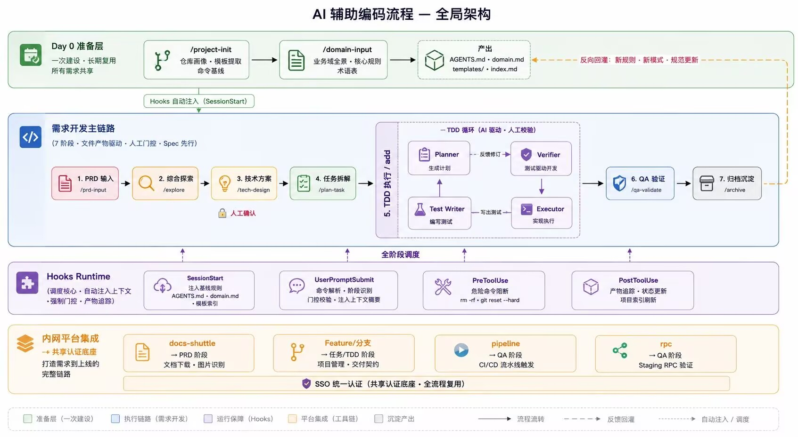

# AI-Native 全流程平台（Spec 驱动的 Agentic Software Engineering）

> **一句话定位**：把「项目初始化 → 需求理解 → 技术设计 → 任务拆解 → TDD 实现 → QA 验证 → 归档沉淀」固化成**可执行、带人工门控、产物落盘**的 AI 研发流水线——用 9 条阶段命令、4 个 Hooks、一套产物契约，让 AI 只能按流程、按契约推进，而不是自由发挥。

AI 写代码不缺能力，缺的是**过程约束**：上下文每次会话重建、阶段靠人脑串联、产物散落在对话里、危险命令无人拦、踩过的坑不沉淀。本平台把流程变成**状态机 + 产物契约 + 门控**：阶段是状态（`.spec/state.json`），产物是阶段间唯一可信输入（`.spec/artifacts/*.md`），越级命令在门控层就被阻断。

> [!IMPORTANT]
> 本项目是**个人同构最小实现（原理复现），非公司代码**，不含任何公司内部资产；取材于 2026.05–2026.09 的研发流程工程化经历。
> 形态：Python 3.11+（**零运行时第三方依赖**，stdlib only）+ Agentic Workflow + Skills / Hooks + Git，交互为 CLI 与本地 Web 控制台（图形 / 终端双模式）。
> 公开仓库只收录源码、项目文档与流程图；`.env`（含真实模型密钥）、`.spec/` 运行时产物、测试临时目录、简历与求职话术类素材均已排除。



> 版本 **v1.4（可运行）** ｜ 更新：2026-11-01 ｜ 文档主线：[需求与场景](./docs/01-需求与场景.md) → [PRD](./docs/02-PRD.md) → [技术方案](./docs/03-技术方案.md) → [产物规范与 Hooks 契约](./docs/04-产物规范与Hooks契约.md) → [里程碑与验收](./docs/05-里程碑与验收.md) ｜ 实现基线：[详细设计与接口契约](./docs/07-详细设计与接口契约.md)、[工程规范](./docs/08-工程规范与开发环境.md)、[测试计划与验收矩阵](./docs/09-测试计划与验收矩阵.md) ｜ 扩展：[Web 控制台](./docs/10-Web控制台.md)、[嵌入其他项目与 Claude Code 示例](./docs/11-嵌入其他项目与ClaudeCode示例.md)

---

## 1. 状态

| 项 | 状态 |
|---|---|
| 文档 | ✅ 收录 10 份（01–05、07–11）；演示脚本与求职话术类文档未收录 |
| 代码 | ✅ `specflow/` 包：9 阶段执行器、4 Hooks、规则引擎、产物管理器、多角色 TDD、平台 mock + HTTP live 适配层、live 模型适配 |
| 测试 | ✅ `python -m pytest -q` → **378 passed**（unit / contract / e2e） |
| 离线演示 | ✅ `python scripts/demo.py --mode mock --reset` 全流程 **≈4.8s（本机实测，目标 ≤90s）** |
| Web 控制台 | ✅ `python -m specflow web --project .demo/visit-import --open`（图形 + 终端双模式） |
| live 演示 | ✅ 已联调：阿里云百炼 `qwen-plus`，全流程 **145.7s**（2026-10-30；9 次模型调用 = 阶段 6 + TDD 3；约 **3.2 万 tokens**；TDD 首轮 3/3） |
| 覆盖验收 | AC-01…AC-22 见 [09 §4](./docs/09-测试计划与验收矩阵.md) |

## 2. 五分钟读懂

1. **问题**：AI 写代码不缺能力，缺的是过程约束——上下文每次重建、阶段靠人脑串、产物散在对话里、危险命令无人拦。
2. **解法**：把流程变成**状态机 + 产物契约 + 门控**。阶段是状态（`.spec/state.json`），产物是唯一可信输入（`.spec/artifacts/*.md`），越级命令在门控层就被 block。
3. **Day 0**：`/project-init` 摸清仓库（画像/模板/命令基线），`/domain-input` 补业务域（规则/术语），产出 `AGENTS.md`、`domain.md`、`templates/`、`index.md`，之后每次会话自动注入。
4. **主链路**：`/prd-input` → `/explore` → `/tech-design` →（`gate approve design`）→ `/plan-task` → `/add` → `/qa-validate` → `/archive` →（`gate approve agents-md`）；S5 内部是 Planner → Test Writer → Executor → Verifier 的 TDD 闭环，失败回流 ≤3 轮。
5. **Hooks**：SessionStart 注入基线；UserPromptSubmit 解析/门控/注入摘要；PreToolUse 阻断 `git reset --hard` 等危险命令并给替代方案；PostToolUse 追踪产物与索引。
6. **闭环**：`/archive` 把新规则写回 `AGENTS.md`，下次 SessionStart 生效——越用越准。

### 2.1 口径校准（防止代码与描述对不上）

- **阶段**：9 个阶段命令 = **2 个上下文初始化**（`/project-init`、`/domain-input`）+ **7 个主链路阶段**（`/prd-input`…`/archive`）；不是“7 个命令”。
- **角色**：4 个角色 = 3 个 LLM Agent（Planner / Test Writer / Executor）+ 1 个**工具型 Verifier**（确定性 pytest 子进程）。工具白名单在 `specflow/agents/roles.py` 硬约束。
- **Hooks**：由宿主生命周期驱动；`specflow hook <Event>` 是统一 runtime 入口，**不内置跨事件调度器**。
- **企业集成**：`MockPlatform` + `HttpPlatform`（REST/Bearer）+ 本地 `scripts/platform_stub.py`；**真实企业网关未接**，需要时配置 `PLATFORM_BASE_URL/TOKEN` 或换实现。
- **认证**：网关负责登录/会话，CLI 只消费 Bearer Token + `whoami()`（用于门控操作人）；CLI 不实现登录系统。
- **测试数字**：以当前 `python -m pytest` 实测为准（378 passed）。

## 3. 快速开始

### 3.1 离线（零依赖、零网络，CI/演示兜底）

```powershell
cd p2-ai-native-platform

# 必需（hooks/宿主集成依赖 console script `specflow`；仅纯 demo 可跳过）
# 开发/仓库内推荐 editable；也支持 pip install .（skills/templates/hooks.json 随包分发）
pip install -e ".[dev]"

python -m pytest -q                              # 378 passed
python -m specflow doctor                        # 环境自检（mock）
python scripts/demo.py --mode mock --reset       # 成功路径全流程（本机实测 ≈4.8s）
python scripts/demo.py --mode mock --reset --fixture pipeline-fail   # 失败分支：QA fail → /archive 被阻断（≈7.3s）
```

> 前置：Python ≥3.11、pip；mock 模式无需网络与 `.env`。wheel 安装不含 `fixtures/demo-repo`（仅仓库内 demo 脚本使用），其余阶段能力随包分发。

`demo.py` 会在 `.demo/visit-import` 复制一份演示仓库（不污染 `fixtures/demo-repo`），依次执行：
`init → /project-init → /domain-input → /prd-input →（越级 /plan-task 被阻断）→ /explore → /tech-design → gate approve design → /plan-task → /add --task T1 → /qa-validate → /archive → gate approve agents-md → status --check → doctor`，最后演示 `git reset --hard` 被 PreToolUse deny。
加 `--fixture pipeline-fail` 时改为失败分支：QA 报告 `verdict=fail` 并定位到 pipeline 段，随后 `/archive` 在门控层被 exit 2 拦住。

### 3.2 接真实模型（live 模式）

```powershell
Copy-Item .env.example .env
# 编辑 .env（默认已配好千问）：
#   LLM_MODE=live
#   LLM_BASE_URL=https://dashscope.aliyuncs.com/compatible-mode/v1
#   LLM_MODEL=qwen-plus
#   LLM_API_KEY=sk-...            # 百炼控制台创建，注意不要提交

python -m specflow doctor                        # 应显示 llm_mode=live, key=set
python scripts/demo.py --mode live --reset       # 真实模型跑同一条流水线
```

- 已实测：`qwen-plus` 全流程 **145.7s**（S0B 27s / S1 15s / S2 12s / S3 23s / S4 18s / S5 30s / S7 18s），模型真实产出方案选型、3 个原子任务、TDD 首轮 3/3 通过、QA 三段全 pass、归档回灌 R-06~R-08；`status --check` 与 `doctor` 均通过。第二次复跑 **165.6s**（网络/限流波动），调用次数不变。
- 模型用量：一次全流程 **9 次调用、约 31,938 tokens**（阶段 6 次 25,671 + TDD 3 次 6,267；Verifier 不调模型）。每次调用的 usage 写入 `.spec/traces/stage-*.jsonl`，可用 `python scripts/usage_report.py --project-dir .demo/visit-import` 核对。
- live 使用 OpenAI 兼容 `/chat/completions`（`urllib` 直连），要求模型输出 JSON；内置 **JSON 解析失败回填重试 1 次**、HTTP/超时重试 1 次。
- live 时延：单阶段约 10–40s、全流程约 2–8min，**不承诺 90s**（mock 才承诺）。换模型/换厂商只需改 `.env` 三行，不改代码。
- 余额/额度：以百炼控制台为准；新用户免费额度通常为各模型百万 tokens 级，本项目一次全流程 9 次调用 / 约 3.2 万 tokens，余量充足。
- `LLM_CACHE=1` 可把真实响应缓存到 `.spec/cache/llm/`，用于现场回放（trace 会标 `cached=true`，不冒充实时）。

### 3.3 Web 控制台（图形 + 终端，双模式可切换）

```powershell
python scripts/demo.py --mode mock --reset                     # 先生成演示仓库
python -m specflow web --project .demo\visit-import --open    # 默认 http://127.0.0.1:8030
```

- **图形界面**：9 阶段流水线与门控状态、产物列表 + Markdown 阅读、Trace 事件、TDD Agent 面板（Planner/Test Writer/Executor/Verifier 逐轮事件）、校验问题、门控一键批准/打回/修订、阶段命令执行（SSE 实时日志）。
- **终端模式**：页面内嵌 CLI，可执行 `status --json`、`doctor`、`init`、`run "/project-init"`、`gate approve design`、`restore design.md`、`unlock design.md --force`；带命令历史（↑/↓）与常用命令快捷按钮。
- 顶部按钮一键切换「图形界面 / 终端」，选择记入 localStorage；真实 CLI（`specflow ...`）始终可用。
- 安全：默认只绑定 `127.0.0.1`；命令不经过 shell 且有白名单；产物/Trace 读取有路径穿越防护。
- 设计参考与接口说明：[docs/10-Web控制台.md](./docs/10-Web控制台.md)。

### 3.4 平台 live 适配层（HTTP + 本地 stub）

平台有两种实现，同一 `PlatformAdapter` 接口：`PLATFORM_MODE=mock`（本地 JSON）与 `PLATFORM_MODE=live`（REST + Bearer）。本地验证不接企业系统：

```powershell
# 终端 A：启动本地 stub（返回 mock_data 预置数据）
python scripts/platform_stub.py --port 8765 --token dev-token

# 终端 B：让 CLI 走 HTTP 平台
$env:PLATFORM_MODE="live"
$env:PLATFORM_BASE_URL="http://127.0.0.1:8765"
$env:PLATFORM_TOKEN="dev-token"
python -m specflow doctor                         # platform_mode=live
python scripts/demo.py --mode mock --reset        # 全链路走 HTTP 平台，LLM 仍 mock
```

- 端点与字段见 `specflow/platforms/http.py` 头部注释；4xx 立即失败，5xx/连接错误重试 1 次，错误统一 `PlatformError`（exit 1）。
- stub 只用于契约与替换性验证；**真实企业接入**需要配置真实网关地址/Token，或新增同接口实现。
- 契约测试：`tests/contract/test_platform_http.py`（本地 127.0.0.1，不访问外网）。
- 身份：`PLATFORM_MODE=live` 时 `gate approve/reject/...` 默认操作人取 SSO `whoami`（本地 stub 为 `lin.xu`）；mock 用 `SPECFLOW_OWNER`；`--as` 可覆盖。
- 文档下载：`/prd-input --doc` 会把原文下载到 `.spec/sources/<doc_id>.md`，并把 OCR 文本带入上下文（`source_meta.downloaded_to`）。
- 分支联动（可选）：`SPECFLOW_GIT_BRANCH=1` 时 `/plan-task` 在目标仓库创建/切换 feature 分支；默认关，不改 commit/push/merge。

## 4. 机制速览

| 机制 | 实现 | 可验证证据 |
|---|---|---|
| 阶段状态机 | `skills/*/SKILL.md` 是唯一事实源；`engine/stages.py` 解析为 `Stage`；`state.json` 记录阶段/门控/轮次 | `tests/unit/test_state.py`、`test_gate.py` |
| 机器门 + 人门 | `engine/gate.py` 纯函数：缺产物 / 状态不符 / hash 篡改直接 block（exit 2）；连续 3 次失败转人工（exit 3） | AC-05…AC-10，`tests/e2e/test_flow.py` |
| 产物契约 | front-matter + 正文章节 + 结构化 JSON 附录；`schema.py` 逐产物强校验 | `tests/unit/test_artifact_schema.py` |
| 版本与一致性 | 覆盖写先备份 `.spec/backup/`；`approved` 产物 hash 锁定，改动判 tampered | AC-10、`gate revise`/`restore` |
| 4 个 Hooks | 独立进程 `specflow hook <Event>`，stdin/stdout JSON，退出码 0/2/3/1；异常默认 fail-open，`SPECFLOW_STRICT_HOOKS=1` fail-closed | `tests/contract/test_hooks.py`、AC-11…AC-14 |
| 规则引擎 | W 白名单短路 → D 危险 deny（带替代方案）→ A 确认 → C 写入范围 | 20 条危险语料/10 条白名单，`tests/unit/test_rules.py` |
| 多角色 TDD | Planner ≤8 步 → TestWriter 先写测试 → Executor 仅改声明文件 → Verifier 真跑 pytest；失败回流 ≤3 轮 | AC-15/16/17、`tests/e2e/test_tdd.py` |
| 平台适配 | docs-shuttle / Feature / pipeline / rpc / SSO 五件套；mock + HTTP live（本地 stub 可验证） | `tests/unit/test_platforms.py`、`tests/contract/test_platform_http.py`、AC-19 |
| 规则回灌 | `/archive` 产出候选规则 → `gate approve agents-md` → 写回 `AGENTS.md §2/§5` → 下次 SessionStart 生效 | AC-20、`tests/e2e/test_flow.py` |
| 可观测 | 每次 hook 一行 JSONL（`.spec/traces/hooks-*.jsonl`）；每次阶段一份 stage trace | `doctor`、trace 文件 |

## 5. CLI 命令表

| 命令 | 说明 |
|---|---|
| `specflow init [--force] [--target PATH]` | 安装 `.spec/` 骨架、`hooks.json`、`AGENTS.md` 初版 |
| `specflow run "/<阶段命令> [参数]"` | 执行阶段（门控 → 执行 → 落产物 → 推进状态） |
| `specflow status [--check] [--json]` | 9 阶段（2 初始化 + 7 主链路）/ 门控 / 产物表格；`--check` 校验字段与 hash |
| `specflow gate approve\|reject\|supersede\|revise <name> --as USER [--note]` | 人工门控；`agents-md` 触发规则回灌 |
| `specflow hook <SessionStart\|UserPromptSubmit\|PreToolUse\|PostToolUse>` | Hook 协议入口（宿主调用） |
| `specflow doctor [--json]` | 环境/配置自检 |
| `specflow restore <name> [--version N]` | 从备份回滚产物 |
| `specflow unlock <name> [--force]` | 清理残留写锁 |

9 条阶段命令：`/project-init`、`/domain-input`、`/prd-input`、`/explore`、`/tech-design`、`/plan-task`、`/add`、`/qa-validate`、`/archive`。
退出码：`0` 成功 · `2` 门控/规则硬阻断 · `3` 需人工 · `1` 运行错误。

## 6. 目录结构

```text
p2-ai-native-platform/
├─ README.md                  # 本文件
├─ pyproject.toml             # 零运行时依赖；console_scripts: specflow
├─ .env.example / hooks.json  # live 模型配置；宿主 hooks 注册
├─ docs/01..11                # 需求 → PRD → 技术方案 → 契约 → 里程碑 → 详细设计 → 工程规范 → 测试矩阵 → Web 控制台 → 嵌入示例
├─ assets/                    # 全局流程图（简历截图未收录）
├─ specflow/                  # 主包（stdlib only）
│  ├─ cli.py config.py errors.py util.py jsonschema.py output_schemas.py doctor.py
│  ├─ engine/                 # stages(解析 SKILL) / state / gate / runner(9 阶段) / actions / status
│  ├─ artifacts/              # frontmatter / store / schema / indexer / lock / feedback
│  ├─ hooks/                  # protocol / manager / rules / 4 个 handler
│  ├─ llm/                    # base / openai_compat(urllib) / mock / mock_data
│  ├─ agents/                 # planner / test_writer / executor / verifier / loop
│  ├─ platforms/              # base / mock / mock_data(5 份)
│  └─ templates/              # 7 份产物模板（含 test_unit.py）
├─ skills/<slug>/SKILL.md     # 9 个阶段契约（front-matter + 中文提示词）
├─ fixtures/demo-repo/        # 离线演示仓库（visit-import：PRD/领域知识/既有测试）
├─ tests/                     # unit / contract / e2e
└─ scripts/                   # demo.py（全流程演示）/ usage_report.py（token 用量）/ dev.ps1（环境准备）
```

运行时产物只写目标仓库：`.spec/{state.json,artifacts,index,traces,backup,locks}` + 仓库根 `AGENTS.md`/`domain.md`/`index.md`/`templates/`。

## 7. 文档索引

| # | 文档 | 内容 |
|---|---|---|
| 1 | [需求与场景](./docs/01-需求与场景.md) | 痛点、角色、9 阶段用户故事、MVP 边界、指标、风险、术语 |
| 2 | [PRD](./docs/02-PRD.md) | 29 条功能（P0/P1）、阶段门控、TDD 循环、Hooks 需求、平台 mock、CLI 表、NFR |
| 3 | [技术方案](./docs/03-技术方案.md) | 选型、架构、目录、模块设计、状态机、时序、降级、测试策略、避坑 |
| 4 | [产物规范与 Hooks 契约](./docs/04-产物规范与Hooks契约.md) | AGENTS/domain 模板、产物字段、hook JSON 协议、退出码、门控表、锁 |
| 5 | [里程碑与验收](./docs/05-里程碑与验收.md) | 7 天拆分、依赖图、AC-01…AC-22、手工步骤、自检清单 |
| 6 | （演示脚本与求职话术类文档） | 非项目素材，未收录进公开仓库 |
| 7 | [详细设计与接口契约](./docs/07-详细设计与接口契约.md) | ADR、数据模型、模块 API、退出码、执行器行为、交付映射（实现唯一基线） |
| 8 | [工程规范与开发环境](./docs/08-工程规范与开发环境.md) | 环境基线、零依赖策略、live 接入、代码/测试/Git 规范、调试、DoD |
| 9 | [测试计划与验收矩阵](./docs/09-测试计划与验收矩阵.md) | 测试分层、离线确定性、AC 矩阵、live 人工验收、已知缺口 |
| 10 | [Web 控制台](./docs/10-Web控制台.md) | 图形/终端双模式、阶段/门控/产物/Trace、TDD Agent 面板、API |
| 11 | [嵌入其他项目与 Claude Code 示例](./docs/11-嵌入其他项目与ClaudeCode示例.md) | 作为 CLI 嵌入目标仓库、Claude Code hooks 配置、crm-service 全流程、边界 |

## 8. 已知限制与口径

- **live 已联调但只测了 `qwen-plus`**（2026-10-30）：百炼 `qwen-plus` 全流程通过；换 DeepSeek/其它 Qwen 型号需按 [08 §1.2 live 模型接入](./docs/08-工程规范与开发环境.md#12-live-模型接入面试演示用) 重跑一次。不同模型对 JSON 输出稳定性有差异，失败时按 07 §7 不落盘、可重试。
- **平台未接真实企业内网**：提供 `MockPlatform`（本地 JSON）与 `HttpPlatform`（REST + Bearer），仓库带 `scripts/platform_stub.py` 本地 stub 验证契约；**不是真实 docs-shuttle/pipeline/rpc/SSO 接入**，真实网关需自行配置或换实现。
- **宿主 hooks 是可选增强**：没有宿主时用 `specflow run` 走同一套引擎（门控/产物/状态一致），只是少了自动注入与自动阻断。
- **并发**：只做单产物文件锁（`O_CREAT|O_EXCL` + TTL），不做多人权限/分支冲突合并。
- **可测指标只讲 mock 口径**：产物齐全率、门控拦截、注入 token 预算、TDD 轮次均可测；**不声称"效率提升 xx%"**（无对照实验）。
- **边界**：本项目只写"同构最小实现 / 原理复现"，不声称重写公司平台，不展示任何公司内部资产。

## 9. 本系列项目

三个仓库互相独立、不共享代码，只共享方法论（上下文分层注入、工具执行治理、状态可追溯）：

| 仓库 | 定位 | 用户 | 形态 |
|---|---|---|---|
| **p2-ai-native-platform**（本仓库） | 研发侧流程工程化：阶段 / 门控 / 产物 / Hooks | 研发工程师、Tech Lead | CLI + 本地 Web 控制台 + 文件产物 |
| [p1-visittong](https://github.com/whs2007/p1-visittong) | 业务侧 Agent Runtime：会话 / Skill / 审批 / Trace | 销售 / BD、销售主管 | Web 工作台 + 后台观测 |
| [p3-agentops](https://github.com/whs2007/p3-agentops) | 通用 Agent 管控原型（P1 后端由其演化） | 平台开发者 | Web 控制台 |

---

代码与文档仅用于学习、演示与技术交流，不含任何公司内部资产。

## 10. 更新记录

- **v1.4（2026-11-01）**：Web 控制台新增 TDD Agent 面板（`/api/agents`，展示四角色逐轮事件/轮次/verdict），对应 `tdd-report.jsonl`；全量 378 passed。
- **v1.3（2026-11-01）**：口径与代码一致性收口——9 命令 = 2 初始化 + 7 主链路；四角色与工具白名单硬约束（`agents/roles.py`）；`max_context_tokens` 真正生效；Hooks/SSO/企业集成口径校准。全量 377 passed。
- **v1.2（2026-11-01）**：平台 live 能力补齐——SSO `whoami` 接门控（`--as` 可覆盖）、`docs_download` 原文落盘 `.spec/sources/`、可选 `SPECFLOW_GIT_BRANCH=1` 创建/切换 feature 分支；全量 370 passed。
- **v1.1（2026-11-01）**：新增平台 live HTTP 适配层（REST + Bearer）与本地 stub；`PLATFORM_MODE=live` + `PLATFORM_BASE_URL`/`PLATFORM_TOKEN` 可跑通，`doctor` 支持 live；新增 9 个契约/配置/e2e 测试，全量 370 passed；真实企业内网仍未接入（口径见 §8）。
- **v1.0.1（2026-10-30）**：live 模型联调通过——阿里云百炼 `qwen-plus` 全流程 145.7s（复跑 165.6s），9 次模型调用、约 3.2 万 tokens，TDD 首轮 3/3，QA 三段 pass，回灌 R-06~R-08，`doctor` / `status --check` 通过；新增 `scripts/usage_report.py` 统计额度消耗。
- **v1.0（2026-10-30）**：文档 01–09 定稿；`specflow` 全量实现；370 项测试通过；离线全流程演示 4.8s（本机）；live 适配器就绪。
- v0.1（2026-10-30）：开发前资料 6 份（需求/PRD/技术方案/契约/里程碑/演示口径）。
