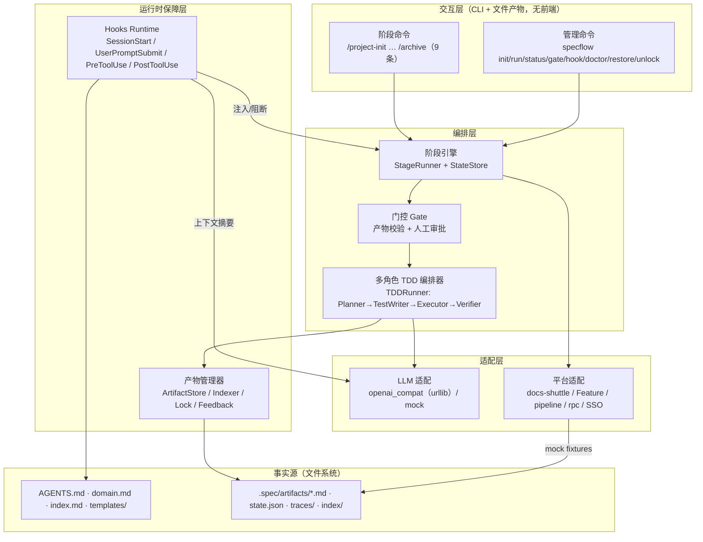

# 02 · PRD

> 项目：AI-Native 全流程平台（Spec 驱动的 Agentic Software Engineering）· 个人同构 MVP
> 版本：v1.0 ｜ 更新：2026-11-01 ｜ 交付状态：**已交付并跑通**——`python -m pytest -q` → **378 passed**，AC-01~22 全部通过（[09 §7](./09-测试计划与验收矩阵.md#7-验收记录与出表)）；mock 全流程 ≈7.5s；**live 已联调**（qwen-plus 145.74s，见 09 §7）
> 上游：[需求与场景](./01-需求与场景.md)、[07 详细设计与接口契约](./07-详细设计与接口契约.md) ｜ 下游：[03 技术方案](./03-技术方案.md)、[04 产物规范与Hooks契约](./04-产物规范与Hooks契约.md)、[08 工程规范与开发环境](./08-工程规范与开发环境.md)、[09 测试计划与验收矩阵](./09-测试计划与验收矩阵.md)

---

## 1. 产品目标与非目标

**目标**：在一个真实仓库里，用 9 条阶段命令（S0A/S0B + S1–S7）+ 4 个 hook，把"需求进 → 代码出 → 知识沉淀"变成可校验、可回滚、可演示的流水线。

**非目标**：不做 Web UI；不做多租户；不做真实内网平台接入；不做通用 Agent 框架（只服务研发流程）。

## 2. 功能架构



分层职责一句话：**命令声明阶段，引擎管状态，门控管准入，Hooks 管注入与安全，文件系统是唯一事实源**。

## 3. 功能清单

优先级：P0 = 演示必须；P1 = 有则更完整；P2 = 本期不做（仅登记）。

| 编号 | 功能 | 优先级 | 描述 | 验收标准 |
|---|---|---|---|---|
| F1.1 | 仓库画像 | P0 | `/project-init` 扫描目录、语言、构建/测试命令，产出 `repo-profile.md` 与 `AGENTS.md` 初版 | 附录含 language/package_manager/test_command/entry_points/commands；命令 ≥3；无网络请求 |
| F1.2 | 模板提取 | P0 | 从仓库既有文档/配置提取命名与文档模板，落到 `templates/` | `templates/` 生成 ≥3 个模板，每个含占位符与示例 |
| F1.3 | 命令基线 | P0 | 记录可执行的构建/测试/lint 命令到 `AGENTS.md §4` | 至少 3 条命令可在目标仓库直接执行且成功 |
| F1.4 | 领域全景 | P0 | `/domain-input` 产出 `domain.md`：业务域、核心规则、术语表 | 术语 ≥8 条、核心规则 ≥5 条、每条规则有反例 |
| F1.5 | 规则反向回灌 | P1 | `/archive` 将新规则/新模式追加到 `AGENTS.md`，版本号递增 | 回灌后 `AGENTS.md` 含 `## 5. 变更记录` 新条目，下次 SessionStart 注入可见 |
| F2.1 | PRD 输入（本地） | P0 | `/prd-input <path>` 读取本地 PRD 并结构化 | 生成 `prd.md`，附录 `requirements[]` ≥1 且每条含编号、描述、验收标准 |
| F2.2 | PRD 输入（docs-shuttle） | P1 | `/prd-input --doc DOC-2041` 从 mock 平台下载/认领文档 | 调 mock 接口成功，产物 `source` 记录 `doc_id` 与图片识别摘要 |
| F2.3 | 综合探索 | P0 | `/explore` 输出受影响模块、现有约束、未知项清单 | `exploration.md` 附录含三节；未知项 ≥1 条且标注"待确认" |
| F2.4 | 技术方案生成 | P0 | `/tech-design` 产出选型对比、模块改动、接口、风险与回滚 | 附录选型 ≥2 个备选；模块改动列出文件路径；风险 ≥3 条且各含回滚 |
| F2.5 | 方案人工门控 | P0 | `design.md` 进入 `draft`，必须 `gate approve design` 才可进入 S4 | 未 approve 时 `/plan-task` 被阻断，退出码 2，提示中含 `design.md` |
| F2.6 | 任务拆解 | P0 | `/plan-task` 把方案拆为原子任务，写 `tasks.md` | 每任务含 `id`、文件范围、`test_first: true`、预估 ≤4h、验收点 |
| F3.1 | TDD 计划 | P0 | Planner 依据任务生成步骤计划 `tdd-plan.md` | 附录 `steps[]` 1..8，每步含目标文件与验证方式；非法任务直接拒绝并说明 |
| F3.2 | 测试先行 | P0 | Test Writer 在实现前写测试，测试文件先落盘 | `tdd-report.jsonl` 中 `event=test_written` 早于 `event=impl_written` |
| F3.3 | 实现执行 | P0 | Executor 按计划实现，仅允许改 `tasks.md` 声明的文件范围 | 越界写入被 `PreToolUse` 规则 C-01 阻断并记录 |
| F3.4 | 验证与反馈 | P0 | Verifier 跑 pytest 并按失败项输出结构化反馈 | 失败时产出 `failure_items[]`，含用例名、错误摘要、建议动作 |
| F3.5 | 失败回流上限 | P0 | 回流修订最多 3 轮，超限转人工 | 第 4 轮不再进入，`tdd-report.md` 标记 `needs_human`，退出码 3 |
| F4.1 | SessionStart 注入 | P0 | 会话开始注入基线规则、模板索引、当前阶段 | 注入 ≤900 tokens；缺失文件时降级为最小规则并告警 |
| F4.2 | UserPromptSubmit 门控 | P0 | 解析命令、识别阶段、校验门控、注入上下文摘要 | 越级命令被 block（exit 2 + stderr）；正常命令注入 ≤300 tokens 摘要 |
| F4.3 | PreToolUse 危险阻断 | P0 | 按规则表判定 `allow/ask/deny` | D-01…D-12 全部 deny；白名单命令全部 allow；决策用 exit 0 + JSON |
| F4.4 | PostToolUse 追踪 | P1 | 写文件后登记产物、刷新 `artifacts.json` 索引、更新状态 | 新增文件出现在索引；索引条目含 stage/task/hash |
| F4.5 | Hook 降级 | P1 | hook 超时/崩溃时按协议降级 + 告警 + 记 trace | 注入类超时（hooks.json 10s）不阻塞会话；阻断类超时默认 fail-open，`SPECFLOW_STRICT_HOOKS=1` 时 fail-closed |
| F5.1 | docs-shuttle mock | P1 | 文档列表/下载/认领/图片识别 | `prd.md` 的 `source` 含 `platform=docs-shuttle` 与 `doc_id` |
| F5.2 | Feature/分支 mock | P1 | 创建 feature 分支、绑定任务、生成交付契约 | `tasks.md` front-matter 含 `feature_id`；交付契约写入 `qa-report.md` |
| F5.3 | pipeline mock | P1 | 触发 CI、轮询结果、回填 QA 报告 | `qa-report.md` 含 `pipeline.run_id`、`status=passed`、耗时 |
| F5.4 | rpc mock | P1 | 对 Staging 方法做契约级调用 | 返回 `ok` 与用例数；失败时在 QA 报告标注 HTTP/gRPC 语义 |
| F5.5 | SSO 身份 | P1 | live 模式门控默认取 `whoami`；mock 用 `SPECFLOW_OWNER`；`--as` 可覆盖 | `state.json` 的 `gates.*.by` 记录解析后的操作人（live=SSO 用户） |
| F6.1 | QA 验证 | P1 | `/qa-validate` 汇总单测、pipeline、RPC 三段证据 | 报告附录 `evidence[]` 覆盖三段 + 总 verdict；任一失败则 verdict=fail |
| F6.2 | 归档沉淀 | P1 | `/archive` 生成变更摘要、回灌规则、刷新索引 | 产出 `archive-record.md`，`index.md` 新增本次需求条目 |
| F6.3 | 状态与自检 | P1 | `specflow status` / `doctor` 展示阶段、门控、环境 | 输出 9 阶段表格（S0A/S0B + S1–S7）+ 检查项；异常项给修复命令 |

## 4. 详细需求

### 4.1 阶段命令与产物契约

阶段定义与提示词的**唯一事实源**是 `skills/<stage>/SKILL.md` 的 front-matter（[ADR-002](./07-详细设计与接口契约.md#0-实现决策记录adr)），`engine/stages.py` 启动时解析：

```yaml
stage: S4
command: /plan-task
title: 任务拆解
requires: [design.md:approved]      # 机器门；可写 artifact.md:approved
human_gate: design                  # 人门：进入本阶段前要求该门 approved；取值 design / agents-md / 空
produces: [tasks.md]
max_context_tokens: 3000
on_fail: keep_previous_artifact
next: S5
```

> `human_gate` 语义是「**进入本阶段前**要求该人门已 approved」：`design` 门挂在 `/plan-task`（S4），**不能**挂在 `/tech-design`（否则 S3 自锁）；`agents-md` 门只用于回灌生效前（[07 §5.1](./07-详细设计与接口契约.md#51-skillsdirskillmd-front-matter唯一事实源)）。

| 阶段 | 命令 | 机器门（缺则阻断） | 人门 | 产物 |
|---|---|---|---|---|
| S0A | `/project-init` | — | — | `AGENTS.md`、`templates/`、`repo-profile.md` |
| S0B | `/domain-input` | `AGENTS.md` | — | `domain.md`、`index.md` |
| S1 | `/prd-input` | — | — | `prd.md` |
| S2 | `/explore` | `prd.md` | — | `exploration.md` |
| S3 | `/tech-design` | `exploration.md` | —（产物进入 `design` 待批） | `design.md` |
| S4 | `/plan-task` | `design.md`（`approved`）+ 人门 `design` | ✅ **阻断**：方案批准（ADR-009） | `tasks.md` |
| S5 | `/add` | `tasks.md` | 建议评审：实现抽检（**非阻断**） | `tdd-plan.md`、`tdd-report.md`、代码 + 测试 |
| S6 | `/qa-validate` | `tdd-report.md`（pass） | 建议评审：交付确认（**非阻断**） | `qa-report.md` |
| S7 | `/archive` | `qa-report.md`（pass） | `agents-md`（在回灌生效前阻断） | `archive-record.md`、更新 `AGENTS.md`/`index.md` |

> 人门注（[ADR-009](./07-详细设计与接口契约.md#0-实现决策记录adr)）：阻断式人门只有 `design`（进 S4 前）与 `agents-md`（回灌生效前）两个；S5 实现抽检 / S6 交付确认是**建议评审项**，不阻断命令执行。`/archive` 本身不被 `agents-md` 阻断——回灌动作由 `specflow gate approve agents-md` 触发。

### 4.2 门控行为

1. **机器门**：检查产物存在 + front-matter 必填字段 + 状态值 + schema/附录校验 + hash 一致性。缺失时 `UserPromptSubmit` 硬阻断：**退出码 2，stderr 单行给出"缺哪份、怎么补"**，不进入模型。
2. **人工门**：`state.json` 记录 `gates.design.status=pending`，用户执行 `specflow gate approve design --as lin.xu --note "选型可接受"`；未批准时越级同样阻断。
3. **打回**：`gate reject design --note "选型缺少压测数据"` → `design.md` 状态回 `draft`，`state.json` 记录轮次与拒绝理由；再次 `/tech-design` 时注入打回意见。
4. **越级防抖**：同一命令连续 3 次门控失败后，输出固定引导（"请先运行 /tech-design"）并停止自动重试，退出码 3（`NeedsHuman`），不再调用 LLM。

### 4.3 多角色 TDD 循环（`/add`）

| 角色 | 输入 | 输出 | 约束 |
|---|---|---|---|
| Planner | `tasks.md` 单个任务 + `design.md` 摘要 + `domain.md` 规则 | `tdd-plan.md`（≤8 步） | 任务范围外的文件不出现在计划里；不满足 `test_first` 直接拒 |
| Test Writer | 计划 + 现有测试风格（`templates/`） | 测试文件 | 先写测试；禁止写实现文件；用例 ≥3 条含 1 条边界 |
| Executor | 计划 + 失败的测试 | 实现文件 | 只能改任务声明的文件范围；不得删改既有测试 |
| Verifier | 测试执行结果（pytest） | `pass` / `fail(failure_items[])` | 只依据测试结果判定，不看"代码看起来对不对" |
| 循环控制器（TDDRunner） | Verifier 结果 | 下一轮计划或终止 | 上限 3 轮；超限 `needs_human` 并保留现场，退出码 3 |

### 4.4 Hooks Runtime 需求

| Hook | 触发 | 必须做的事 | 失败策略 |
|---|---|---|---|
| `SessionStart` | 会话开始/恢复 | 注入 `AGENTS.md` 规则摘要、模板索引、当前阶段与门控状态 | 缺失文件 → 注入最小规则 + 告警，不阻断 |
| `UserPromptSubmit` | 每次提交 | 命令解析 → 阶段识别 → 门控校验 → 注入上下文摘要（≤300 tokens） | 门控失败 → exit 2 + stderr 硬阻断；解析异常 → 按普通对话放行（exit 0） |
| `PreToolUse` | 每次工具调用前 | 命令/路径规则匹配 → `allow/ask/deny` + 理由 + 替代方案 | **exit 0 + JSON** 表达决策；异常 → fail-open + 告警（`SPECFLOW_STRICT_HOOKS=1` 切 fail-closed） |
| `PostToolUse` | 每次工具调用后 | 产物登记、hash、状态流转、`artifacts.json` 刷新 | 异常 → 记 trace，不阻断 |

Hook 必须满足：单次执行 P95 ≤300ms（mock 模式口径）；不联网；不修改 `.spec/artifacts` 正文（只读 + 索引）；所有决策写 `.spec/traces/hooks-YYYYMMDD.jsonl`；stdout 只输出单行合法 JSON。

### 4.5 平台集成（mock + HTTP live 适配层；真实企业未接）

| 平台 | 用途阶段 | mock 接口 | 数据来源 |
|---|---|---|---|
| docs-shuttle | S1 | `docs_list/docs_get/docs_claim/docs_ocr` | `specflow/platforms/mock_data/docs_shuttle.json` |
| Feature/分支 | S4、S5 | `feature_create/feature_bind/feature_contract` | `specflow/platforms/mock_data/feature.json` |
| pipeline | S6 | `pipeline_trigger/pipeline_status` | `specflow/platforms/mock_data/pipeline.json`（默认 passed；另含 1 个 failed run 供失败分支演示） |
| rpc | S6 | `rpc_call(method, payload)` | `specflow/platforms/mock_data/rpc.json`（`ok` / `error` 两种响应） |
| SSO | 仅平台适配演示（未参与门控） | `whoami` | `specflow/platforms/mock_data/sso.json` |

切换方式：`.env` 的 `PLATFORM_MODE=mock|live`（mock=本地 JSON；live=HTTP REST 适配层，需 `PLATFORM_BASE_URL`/`PLATFORM_TOKEN`）；两者同一 `PlatformAdapter` 接口，换实现不改调用方。live 下：门控默认操作人取 SSO `whoami`；`docs_download` 把 PRD 原文落到 `.spec/sources/`；`docs_ocr` 返回图片文本；`SPECFLOW_GIT_BRANCH=1` 时 `/plan-task` 创建/切换 feature 分支。真实企业内网仍需另行对接，仓库提供的是同构 HTTP 实现 + 本地 stub。

### 4.6 规则回灌

`/archive` 生成 `archive-record.md` 时输出候选规则块（结构化数据在正文末尾附录，见 [04 §4](./04-产物规范与Hooks契约.md#4-各阶段产物最小必备字段)）：

````markdown
## 附录：结构化数据

```json
{"rules_proposed": [
  {"id": "R-07", "text": "新增接口必须提供 400/409 两种失败用例", "source": "visit-import", "criteria": "接口测试缺少失败用例", "counterexample": "只测 200"},
  {"id": "R-08", "text": "金额字段一律用 Decimal，禁止 float", "source": "visit-import", "criteria": "出现 float 金额", "counterexample": "amount: float"}
]}
```
````

人工确认（`specflow gate approve agents-md --as <你>`）后由 `artifacts/feedback.py` 追加到 `AGENTS.md` 的 `## 2. 工程规则`，并在 `## 5. 变更记录` 写 `- v0.3 ← 回灌 R-07、R-08（来源：需求 visit-import）`；下一次 `SessionStart` 注入生效。相似度 ≥0.9 跳过；§2 硬上限 30 条。

## 5. CLI 命令表

**阶段命令**（在宿主会话内使用，由 `UserPromptSubmit` 解析；无宿主时用 `specflow run "<命令>"` 走同一引擎，ADR-005）：

| 命令 | 参数 | 说明 |
|---|---|---|
| `/project-init` | `[--force]` | 仓库画像 + 模板提取 + 命令基线 |
| `/domain-input` | `[--file path]` | 业务域全景 + 核心规则 + 术语表 |
| `/prd-input` | `<file>` \| `--doc DOC-ID` | PRD 输入（本地或 docs-shuttle） |
| `/explore` | `[--scope path]` | 综合探索 |
| `/tech-design` | `[--note "打回意见"]` | 技术方案 |
| `/plan-task` | `[--max-hours 4]` | 任务拆解 |
| `/add` | `[--task T1]` \| `[--all]` | TDD 执行 |
| `/qa-validate` | `[--skip-rpc] [--fixture pipeline-fail]` | QA 验证（三段证据） |
| `/archive` | `[--dry-run]` | 归档 + 回灌 |

**管理命令**（shell，以 [07 §5.10](./07-详细设计与接口契约.md#510-执行器与-cli) 为准）：

| 命令 | 说明 |
|---|---|
| `specflow init [--force]` | 在目标仓库安装 `hooks.json`、`.spec/` 五目录 + `state.json`、`AGENTS.md` 初版 |
| `specflow run "<命令>" [参数]` | 降级手动执行，如 `specflow run "/prd-input docs/prd/visit-import.md"`、`specflow run "/add --task T1"` |
| `specflow status [--check] [--json]` | 打印 9 阶段 / 门控 / 产物表；`--check` 跑 schema + hash 校验 |
| `specflow gate approve\|reject\|supersede\|revise <name> --as <user> [--note]` | 人工门控；`agents-md` 触发回灌 |
| `specflow hook <Event>` | hook 入口（读 stdin JSON，写 stdout JSON）；供宿主调用 |
| `specflow restore <name> [--version n]` | 从 `.spec/backup/` 回滚产物（如 `restore design.md`） |
| `specflow unlock <name> [--force]` | 清理残留写锁（打印持锁 owner/pid 后再删） |
| `specflow doctor [--json]` | 环境与配置自检（LLM/模式/fixtures/权限） |

退出码（[ADR-010](./07-详细设计与接口契约.md#0-实现决策记录adr)）：`0` 成功 · `2` 门控/规则硬阻断 · `3` 需要人工介入（如 TDD 超限、写锁占用）· `1` 运行错误。注意 **`PreToolUse` 的 deny/ask 是 exit 0 + JSON**，只有 `UserPromptSubmit` 门控失败才用 exit 2 + stderr（详见 [04 §5.1](./04-产物规范与Hooks契约.md#51-注册与环境)）。

## 6. 非功能需求

| 维度 | 要求 | 验证 |
|---|---|---|
| 离线可用 | `LLM_MODE=mock` + `PLATFORM_MODE=mock` 时零 socket 连接 | 断网跑完整演示脚本；AC-21 socket 打桩 |
| 性能 | hook P95 ≤300ms；单阶段产物生成 ≤20s（**mock 模式口径**；live 不承诺） | trace 统计 |
| 可观测 | 每次 hook 一行 JSONL；每次阶段执行一份 trace | 抽样检查字段完整性 |
| 可回滚 | 产物覆盖写前保留 `.spec/backup/<stem>.v<n>.md`；`AGENTS.md` 备份为 `AGENTS.v<n>.md` | 人为删产物后 `specflow restore` |
| 一致性 | 已 `approved` 产物 hash 变化必须重新门控 | AC-10 |
| 可移植 | Windows / macOS / Linux 均可跑（纯 `pathlib`，无 shell 依赖） | `doctor` 三平台清单 |
| 安全 | 不执行任意网络调用；危险命令按规则表阻断；mock 数据不含真实业务 | 规则用例 + 素材脱敏 |

## 7. 演示脚本（完整版、mock/live 两套时长见 [06](./06-演示脚本与面试口径.md)）

1. `specflow init` → 展示 `.spec/` 骨架与 `hooks.json`。
2. `specflow run "/project-init"` → `AGENTS.md` + `templates/` 落盘。
3. `specflow run "/prd-input docs/prd/visit-import.md"` → `prd.md`。
4. 直接 `specflow run "/plan-task"`（越级）→ 被门控阻断（exit 2），展示 stderr 提示与 trace。
5. `specflow run "/explore"` → `specflow run "/tech-design"` → `specflow gate approve design --as lin.xu --note "选型可接受"` → `specflow run "/plan-task"`。
6. `specflow run "/add --task T1"` → 展示 `tdd-plan.md`、测试先落盘、Verifier 首轮失败、回流后 pass。
7. 让 AI 执行 `git reset --hard HEAD~3` → `PreToolUse` 15 秒阻断（exit 0 + `permissionDecision=deny`）。
8. `specflow run "/qa-validate"` → 三段证据；`specflow run "/archive"` → `specflow gate approve agents-md --as lin.xu` → 重开会话看注入生效；`specflow status --check`、`specflow doctor` 收尾。