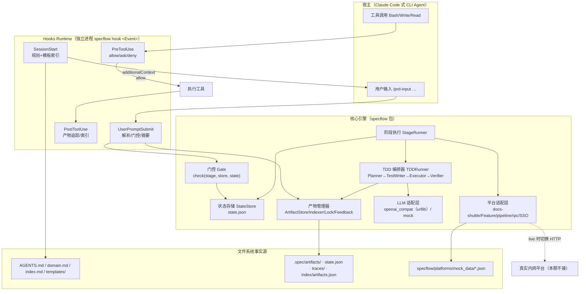
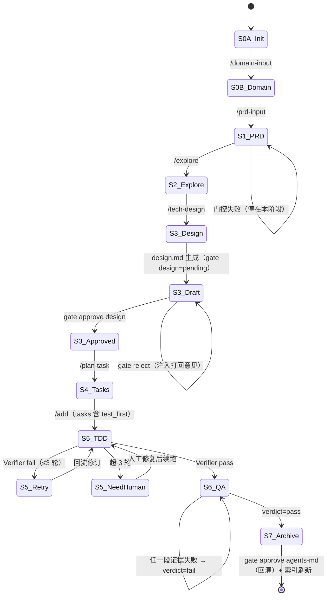
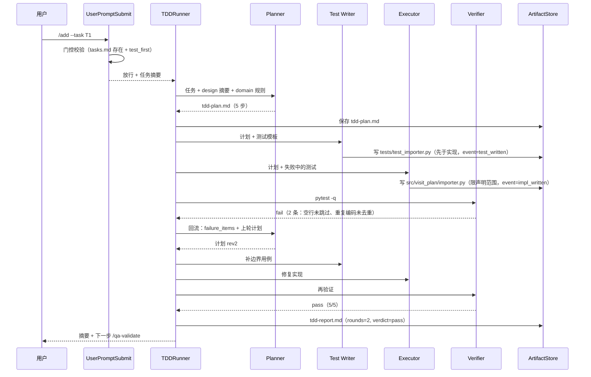

# 03 · 技术方案

> 项目：AI-Native 全流程平台（Spec 驱动的 Agentic Software Engineering）· 个人同构 MVP
> 版本：v1.0 ｜ 更新：2026-11-01 ｜ 交付状态：**已交付并跑通**——代码按 [07](./07-详细设计与接口契约.md) 落地，`python -m pytest -q` → **378 passed**，mock 全流程 ≈7.5s；**live 已联调**（qwen-plus 145.74s，见 09 §7）
> 上游：[PRD](./02-PRD.md) ｜ 下游：[产物规范与Hooks契约](./04-产物规范与Hooks契约.md)、[里程碑与验收](./05-里程碑与验收.md)、[07 详细设计与接口契约](./07-详细设计与接口契约.md)、[08 工程规范与开发环境](./08-工程规范与开发环境.md)、[09 测试计划与验收矩阵](./09-测试计划与验收矩阵.md)
> 口径：本文的架构描述服从 [07](./07-详细设计与接口契约.md) 的 ADR 与接口契约；字段/签名/退出码若与 07 冲突，以 07 为准。

---

## 1. 技术选型

| 层 | 选型 | 理由 | 备选与代价 |
|---|---|---|---|
| 语言/运行时 | **Python 3.11+，零运行时第三方依赖，纯 stdlib**（live 模型 HTTP 用 `urllib.request`） | 面试现场零安装即可跑；避免 `httpx`/`pydantic` 与 Python 3.14 的兼容坑（[ADR-001](./07-详细设计与接口契约.md#0-实现决策记录adr)） | Node/TS：hook 冷启动更快但生态重，且本 MVP 无前端 |
| 流程编排 | **自研阶段引擎 + 显式状态机**（`StageRunner` + `StateStore`） | 9 个阶段是有限、可枚举的；状态机几十行能写清，出错可定位到"哪个转移" | LangGraph：图能力强，但把"阶段/门控"抽象成通用图后，演示时讲不清边界 |
| 多角色编排 | **顺序角色链 + 结构化 JSON 交接**（`TDDRunner`） | 4 个角色是流水线而非自由对话；顺序 + 契约可测、可回放 | CrewAI / AutoGen：自由协商，不可复现，TDD 失败回流难约束 |
| RAG/检索 | 不用向量库，**索引 + 按需读文件** | 仓库知识是结构化文件，精确路径比相似度可靠 | LlamaIndex：引入 embedding/存储，离线演示反而更脆 |
| LLM | OpenAI 兼容协议（`/chat/completions`，`urllib`）+ **Mock 模型（scenario 查表）** | DeepSeek/Qwen/vLLM 通用；Mock 保证离线可跑与测试确定性（[ADR-004](./07-详细设计与接口契约.md#0-实现决策记录adr)） | 绑定 SDK：换模型改代码 |
| 状态与产物 | 文件系统（Markdown + JSON + JSONL） | 产物要能 `git diff`、能被人读、能被下一个 Agent 读；零服务依赖 | SQLite：查询强，但产物正文仍得落盘，双写一致性成本高 |
| Hook 协议 | stdin/stdout JSON + 退出码（Claude Code 风格） | 宿主无关，`specflow hook <Event>` 是独立进程，可单测 | 自研事件总线：绑定自家 Runtime |
| 并发控制 | 文件锁（`O_CREAT\|O_EXCL`）+ 单写者原则 | 同仓库多人/多会话时防写坏；不引入 Redis | 进程内 `asyncio.Lock`：跨进程无效 |
| 测试 | `pytest`（dev 依赖）+ fixture 仓库 + mock scenario | 每个测试在临时目录里建最小仓库，可断言产物；离线确定 | 端到端真实模型：慢、不可复现 |

**已作废的旧选型**（按 ADR 定稿）：`httpx + pydantic`（ADR-001 → 零依赖 + 手写轻量 `jsonschema.py`）、`mock 按输入指纹（sha1）查表`（ADR-004 → 按 `scenario` 查表，scenario 由 runner 生成、可带 `round`）、`SQLite/向量库`（不引入）。

**和"通用 Agent 框架"的根本差别**：LangChain/LlamaIndex/CrewAI 解决"如何让模型自由使用工具/自由协作"；本项目解决"如何让模型**只能**在既定阶段、既定产物契约内工作"。前者优化能力上限，后者优化**过程可约束性**——所以核心不是 Agent 循环，而是**阶段契约 + 门控 + 产物事实源**。

## 2. 总体架构



## 3. 目录结构

### 3.1 平台仓库（本仓库，工具实现）

以 [07 §1 包结构与依赖方向](./07-详细设计与接口契约.md#1-包结构与依赖方向) 为准：

```text
p2-ai-native-platform/
├─ README.md                      # 入口：定位、素材、文档索引、5 分钟读懂
├─ pyproject.toml                 # 包元数据；dependencies = []，dev 仅 pytest；console_scripts: specflow
├─ .env.example                   # LLM_MODE / LLM_BASE_URL / PLATFORM_MODE / 预算与上限
├─ hooks.json                     # 宿主 hooks 注册：事件 → matcher → 命令 + 超时
├─ docs/                          # 01~09 文档（与代码同仓便于交叉校验）
├─ assets/                        # 流程图 + 简历截图（只读素材）
├─ specflow/                      # 主包（__version__ = "1.0.0"）
│  ├─ __init__.py / __main__.py   # python -m specflow 入口
│  ├─ cli.py                      # 子命令：init/run/status/gate/hook/doctor/restore/unlock
│  ├─ config.py                   # Settings：env + .env + 覆盖项
│  ├─ errors.py                   # 异常与退出码
│  ├─ util.py                     # 时间/hash/token 估算/原子读写
│  ├─ jsonschema.py               # 轻量 JSON Schema 校验（type/required/properties/items/enum…）
│  ├─ engine/
│  │  ├─ stages.py                # 解析 skills/*/SKILL.md → Stage
│  │  ├─ state.py                 # StateStore：state.json 原子读写 + 转移
│  │  ├─ gate.py                  # 机器门 + 人门检查（纯函数）
│  │  └─ runner.py                # StageRunner：9 个阶段 handler
│  ├─ artifacts/
│  │  ├─ frontmatter.py           # YAML 子集解析/渲染 + TOC
│  │  ├─ store.py                 # ArtifactStore.load/save/backup/restore
│  │  ├─ schema.py                # 各产物必备字段 + 章节 + 附录结构校验
│  │  ├─ indexer.py               # artifacts.json + index.md 刷新
│  │  ├─ lock.py                  # 跨进程文件锁
│  │  └─ feedback.py              # 规则回灌（追加 AGENTS.md）
│  ├─ hooks/
│  │  ├─ protocol.py              # stdin/stdout/退出码/注入载荷
│  │  ├─ manager.py               # 事件分发 + trace（超时由宿主 hooks.json 控制）
│  │  ├─ rules.py                 # W/D/A/C 规则表 + 匹配器
│  │  ├─ session_start.py         # 注入基线/模板索引/阶段
│  │  ├─ user_prompt_submit.py    # 命令解析/门控/摘要注入
│  │  ├─ pre_tool_use.py          # allow/ask/deny + C 类范围检查
│  │  └─ post_tool_use.py         # 产物与代码文件追踪
│  ├─ llm/
│  │  ├─ base.py                  # LLMClient 协议 + LLMResult
│  │  ├─ openai_compat.py         # urllib 直连 + JSON 纠错重试 + 可选缓存
│  │  ├─ mock.py                  # scenario 查表
│  │  └─ mock_data.py             # mock 响应常量（含首轮失败脚本）
│  ├─ agents/
│  │  ├─ base.py                  # AgentContext / AgentResult
│  │  ├─ planner.py               # 任务 → ≤8 步计划
│  │  ├─ test_writer.py           # 先写测试
│  │  ├─ executor.py              # 范围白名单内写实现
│  │  ├─ verifier.py              # 跑 pytest，产出 failure_items
│  │  └─ loop.py                  # TDDRunner：≤3 轮回流 + 事件流
│  ├─ platforms/
│  │  ├─ base.py                  # PlatformAdapter 协议
│  │  ├─ mock.py                  # 读 mock_data/*.json，支持失败 fixture
│  │  ├─ mock_data/               # docs_shuttle/feature/pipeline/rpc/sso.json
│  │  └─ __init__.py              # get_platform(settings)
│  └─ templates/                  # 产物模板（prd/design/tasks/test_unit…）
├─ skills/<9 个阶段>/SKILL.md      # 阶段契约（front-matter 唯一事实源）
├─ fixtures/demo-repo/            # 离线演示仓库（只读）
├─ tests/                         # unit / contract / e2e
└─ scripts/demo.py + dev.ps1      # demo.py：全流程演示/复位（--mode mock|live、--reset）；dev.ps1：Windows 环境准备
```

**依赖方向（禁止反向 import）**：

```text
config / errors / util / jsonschema          （最底层，无内部依赖）
        ↑
artifacts ← engine.stages/state/gate ← engine.runner → agents → llm
                                     ↘ hooks → artifacts/engine.state
                                     ↘ platforms
cli → engine.runner / hooks.manager / engine.gate / artifacts.*
```

### 3.2 目标仓库（被改造的业务仓库，运行时生成）

```text
<target-repo>/
├─ AGENTS.md                 # 基线规则 + 命令基线 + 变更记录（工具写，人可读）
├─ domain.md                 # 业务域全景 / 核心规则 / 术语表
├─ index.md                  # 知识索引：阶段产物、模块、历史需求
├─ templates/                # 从仓库提取的模板（PRD/测试/命名），可被回灌更新
├─ .spec/
│  ├─ state.json             # 当前阶段 + 门控 + 版本 + 轮次
│  ├─ artifacts/             # 唯一可信产物：repo-profile/prd/exploration/design/tasks/tdd-plan/tdd-report/qa-report/archive-record
│  ├─ index/artifacts.json   # 产物索引：path→stage/task/hash/mtime
│  ├─ traces/                # hooks-YYYYMMDD.jsonl + stage-<slug>-<ts>.jsonl
│  ├─ backup/                # 覆盖写前的旧版本（<stem>.v<n>.md）
│  ├─ locks/                 # 写锁文件（含 pid/owner/expire_at）
│  └─ cache/llm/             # live 响应缓存（LLM_CACHE=1 时）
└─ (业务代码)                 # 仅被 /add 按 tasks.md 声明的范围修改
```

> 原则：**平台仓库管"怎么做"，目标仓库管"这次做了什么"**。全局配置只读 `.env` 与 `hooks.json`，业务事实全部留在目标仓库，便于随代码一起 review。

## 4. 模块设计

### 4.1 阶段引擎与状态机（`engine/`）

阶段定义是**数据**不是代码：`skills/<stage>/SKILL.md` 的 front-matter 是唯一事实源（[ADR-002](./07-详细设计与接口契约.md#0-实现决策记录adr)），`engine/stages.py` 启动时解析成 frozen dataclass `Stage`（`id/command/slug/title/requires/produces/human_gate/max_context_tokens/next`）。门控、注入、CLI 三处共用同一份事实。

执行一次阶段 = 5 步（`StageRunner.run(stage, args)`）：解析命令 → 门控校验（`gate.check(stage, store, state)`）→ 组装上下文（规则摘要 + 上游产物 summary/toc + 锚点路径）→ 调 LLM 产出结构化 JSON → 按 schema 校验后渲染模板落盘 + 状态转移。任一步失败都不污染状态：产物写入前存 `.spec/backup/` 再 `tmp + os.replace` 原子替换，`state.json` 同样原子写。

### 4.2 Agent 编排器（`agents/loop.py`）

角色之间**只用结构化 JSON 交接**，不共享对话历史（避免上下文互相污染）：

```python
for round in range(1, settings.max_rounds + 1):
    plan   = planner.plan(ctx)                    # data={"steps": [...]}，≤8 步
    tests  = test_writer.write(ctx)               # 先落盘测试
    impl   = executor.apply(ctx)                  # 仅 tasks.md 声明范围
    verdict = verifier.run(ctx, test_files)       # [sys.executable, "-m", "pytest", "-q", *files]
    if verdict["passed"]:
        break
    ctx.failure_items = verdict["failure_items"]  # 失败项回流下一轮计划
else:
    state_store.set_needs_human(True)             # 保留现场，交人工
```

约束：`executor` 的写入路径先过 C 类范围检查（`check_path_scope`，是否在 `tasks.md` 声明范围内）；`test_writer` 试图写实现文件直接 deny；每一步把事件追加到 `.spec/artifacts/tdd-report.jsonl`——行 = [07 §3.4](./07-详细设计与接口契约.md#3-数据模型文件级) 的公共字段（`ts/stage/step/status/...`）之上顶层追加 `round/role/event`（[07 §5.8](./07-详细设计与接口契约.md)），`event` 承载 `plan_ready/test_written/impl_written/fail/pass` 语义事件，顺序可断言（AC-15）。

### 4.3 Hooks 管理器（`hooks/`）

- 进程模型：宿主 spawn `specflow hook PreToolUse`，stdin 一个 JSON，stdout 一个 JSON 或空，**完成即退出**（无长驻状态）。
- 分发：`manager.py` 按 `hook_event_name` 路由；超时由 `hooks.json` 配置（SessionStart / UserPromptSubmit 10s，PreToolUse / PostToolUse 5s），LLM/子进程另有独立超时；超时走各自降级策略。
- 规则引擎：`pre_tool_use.py` 维护四张表——`W`（放行白名单，优先短路）、`D`（危险命令，deny）、`A`（需确认，ask）、`C`（写入范围/角色约束，需上下文）。先白名单后危险表，避免"重构脚本里含 rm 就误杀"。
- 退出码：`PreToolUse` 的 allow/ask/deny 一律 **exit 0 + stdout JSON `permissionDecision`**；只有 `UserPromptSubmit` 门控失败才 **exit 2 + stderr**（[ADR-010](./07-详细设计与接口契约.md#0-实现决策记录adr)、[04 §5.1](./04-产物规范与Hooks契约.md#51-注册与环境)）。
- 可观测：每次调用一行 JSONL（`event`、`decision`、`rule_id`、`exit_code`、`elapsed_ms`、`context_tokens`、`artifact_refs`、`error`），这也是 M3/M5 指标的原始数据。

### 4.4 产物管理器（`artifacts/`）

| 能力 | 实现要点 |
|---|---|
| 读写 | 统一 `ArtifactStore.load/save`，front-matter 用 YAML 子集手写解析（避免引入 pyyaml 全量依赖，ADR-003） |
| 校验 | `schema.py` 声明各产物必备 meta 字段、必备章节与 `## 附录：结构化数据` 的 JSON Schema；用 `specflow/jsonschema.py`（支持 type/required/properties/items/enum/const/minItems/minLength/minimum）校验；`status --check` 与门控共用 |
| 版本 | 每次 `save` 前把旧文件复制到 `.spec/backup/<stem>.v<old_version>.md`，回滚 = 复制回来 |
| 一致性 | front-matter 的 `hash` 只对正文（`---` 之后）算 sha256 前 12 位（ADR-006）；`approved` 状态下 hash 不匹配即视为"被篡改"，门控拒绝 |
| 索引 | `indexer.py` 增量更新 `artifacts.json`（dict 落盘）+ 重建 `index.md` 的表格段（保持人读友好） |
| 回灌 | `feedback.py` 只做"追加 + 变更记录"，不自动改旧规则，冲突交人工；§2 硬上限 30 条 |

### 4.5 LLM 适配层（`llm/`）

统一接口 `LLMClient.complete(messages, *, schema=None, scenario=None, round=None, temperature=None) -> LLMResult`（`text/data/usage/model/mode/elapsed_ms/cached`）：

- **live**（`openai_compat.py`）：`POST {base_url}/chat/completions`，`urllib.request` + `timeout=llm_timeout_s`；带 `schema` 时 system 追加"只输出 JSON"，请求体带 `response_format={"type":"json_object"}`（服务端不支持则去掉该字段重试一次）；JSON 解析/校验失败 → 把错误回填给模型纠错 1 次，二次失败抛 `LLMError`（不落盘）；HTTP 非 2xx/超时重试 1 次。`LLM_CACHE=1` 时缓存到 `.spec/cache/llm/`，trace 标 `cached=true`。
- **mock**（`mock.py`）：按 `scenario` 查表（`mock_data.RESPONSES`，元素可带 `round`），返回深拷贝并用 schema 校验（失败直接抛，暴露 fixture 问题）；无网络、无 sleep、无随机。覆盖 scenario：`domain-input`、`prd-input`、`explore`、`tech-design`、`plan-task`、`archive`、`tdd-plan`、`tdd-tests`、`tdd-impl`（`round=1` 故意有缺陷、`round=2` 修复）。

### 4.6 平台适配层（`platforms/`）

`PlatformAdapter` 协议覆盖 docs / feature / pipeline / rpc / sso；`get_platform(settings)` 按 `PLATFORM_MODE` 返回 `MockPlatform`（本地 JSON）或 `HttpPlatform`（REST + Bearer，`PLATFORM_BASE_URL`/`PLATFORM_TOKEN`）。HTTP 实现定义在 `specflow/platforms/http.py`（端点/字段见文件头注释），内置 4xx 立即失败、5xx/连接错误重试 1 次、统一 `PlatformError`。仓库带 `scripts/platform_stub.py` 本地 stub，可离线验证同一契约；**真实企业内网仍需对接**。mock 的失败样例仍预置（`pipeline-fail`/`rpc-error`），所有调用写 trace。

## 5. 阶段状态机



状态持久化在 `.spec/state.json`（字段以 [07 §3.1](./07-详细设计与接口契约.md#31-specstatejson) 为准）：

```json
{
  "schema_version": 1,
  "stage": "S3",
  "owner": "lin.xu",
  "artifacts": {
    "design.md": {"version": 2, "hash": "9f2c1a7b4d05", "status": "approved",
                  "stage": "S3", "updated_at": "2026-10-30T20:31:40+08:00"}
  },
  "gates": {
    "design":    {"status": "approved", "by": "lin.xu", "note": "选型可接受",
                  "at": "2026-10-30T20:14:03+08:00", "round": 2},
    "agents-md": {"status": "pending"}
  },
  "rounds": {"S5": 1},
  "gate_failures": {"plan-task": 1},
  "needs_human": false,
  "last_command": "/add",
  "updated_at": "2026-10-30T20:42:31+08:00"
}
```

## 6. 多角色 TDD 时序



## 7. 异常与降级

| 场景 | 行为 | 用户可见 |
|---|---|---|
| LLM 超时/非 2xx | 重试 1 次；仍失败抛 `LLMError`，该阶段不落盘；state 仅记录 `last_command` 等运行痕迹，阶段不推进（退出码 1） | "阶段未完成，产物未改动，可重试" |
| LLM 返回非法 JSON | 把校验错误回填模型纠错 1 次；二次失败 `LLMError`，不落盘（退出码 1） | 错误信息 + 可重试提示 |
| 上游产物缺失/状态不符/hash 篡改 | 门控阻断（exit 2），打印 `missing` + `howto`，不调 LLM | 明确"缺什么、跑什么" |
| 人门未批准 | 门控阻断（exit 2） | 提示 `specflow gate approve design --as <你>` |
| 连续 3 次门控失败（同一命令） | `NeedsHuman`（exit 3），停止自动重试 | 固定引导语 |
| `AGENTS.md`/`domain.md` 缺失 | SessionStart 注入内置最小规则 + 告警条 | 会话可继续 |
| hook 超时/崩溃 | 默认 fail-open（allow/continue + trace error）；`SPECFLOW_STRICT_HOOKS=1` → fail-closed | 一行警告 + trace |
| 危险命令 | PreToolUse `deny`（exit 0 + JSON）+ 理由 + 替代方案 | 模型收到 `permissionDecisionReason` |
| 并发写同一产物 | `LockBusy`（exit 3），提示持锁者 pid/剩余 TTL | "另一个会话正在写 design.md" |
| TDD 超 3 轮 | `needs_human`，保留测试与失败现场（exit 3） | 摘要 + 失败项清单 |
| 子进程 pytest 超时 | `failure_items=[{case:"<pytest>",error:"timeout"}]`（exit 3） | 失败项 + 建议 |
| approved 产物被改 | hash 不匹配 → 门控拒绝，要求重新审批 | 表格里标 `tampered` |
| mock 数据缺失 scenario / 损坏 | `UsageError`（exit 1，暴露 fixture 问题）；平台子域降级为 `skipped` 并在报告标注 | 报告标注 + 三平台一致 |

## 8. 测试策略

测试分层、目录、AC 矩阵与离线确定性策略见 [09 测试计划与验收矩阵](./09-测试计划与验收矩阵.md)；本节只给总原则。

| 层级 | 覆盖对象 | 方式 | 关键断言 |
|---|---|---|---|
| 单元 | 状态机转移、门控字段校验、规则引擎、产物 store/schema、TDD 循环 | 纯函数/单模块，无网络 | 非法转移报错；D-01…D-12 全 deny；越界写 deny；hash 篡改可检测 |
| 契约 | 4 个 hook 的 stdin/stdout 协议 | 真子进程 `python -m specflow hook <Event>`，比对 stdout JSON 结构 | 退出码、必填键、`context_tokens` 不超预算；PreToolUse 决策走 exit 0 + JSON |
| 端到端 | 阶段引擎 + 产物管理器 + CLI | 临时仓库副本（`tmp_path`）跑 S0A→S7，mock LLM | 产物附录字段完整、`state.json` 阶段正确、索引含新条目 |
| 回归 / 离线 | 演示脚本全流程（mock） | socket 打桩 + `LLM_MODE=mock`，断言零网络、时长 ≤90s（AC-21；实测 ≈7.5s、全量 378 passed） | 全流程可重复、可复位 |

测试确定性靠四点：**LLM 走 mock scenario 查表**（ADR-004）、**时间用 monkeypatch 固定**（`specflow.util.now_iso`）、**hash 只对正文**（ADR-006，避免 front-matter 时间戳影响一致性）、**每个用例在 `tmp_path` 的仓库副本里跑**（禁止写 `fixtures/demo-repo`）。

## 9. 避坑指南（三个真正会卡住的地方）

### 难点 1：阶段漂移——模型总是"顺手"把后面几步也做了

**现象**：`/tech-design` 的产物里出现任务拆解甚至代码片段；或用户说"直接实现吧"，模型跳过方案与拆解。**根因**：阶段只存在于提示词里，而模型的目标函数是"尽快满足用户"，不是"遵守流程"。

**解法**：
1. **阶段是状态，不是措辞**：`state.json` 存当前阶段；每个命令进入前由 `gate.check(stage, store, state)` 按 `skills/*/SKILL.md` 的 `requires` 校验（产物存在/状态/hash/schema），越级在 `UserPromptSubmit` 就被 block，模型根本没机会。
2. **产物契约反向约束**：每个阶段只给一个 JSON schema，schema 里没有"任务列表"字段，模型无处安放越界内容；渲染模板也不给它留章节。
3. **越界检测 + 口径**：落盘前做结构检查（如 `design.md` 的 schema 未登记「任务拆解」章节，出现即判越界/校验失败），失败要求重写而不是让人工删；对外别说"AI 很听话"，要说"越界在结构上不可表达"。

### 难点 2：上下文注入体积——每次都塞全文，token 与注意力双爆

**现象**：SessionStart 注入 `AGENTS.md` 全文 + 全部模板 + 历史产物，单次 20k+ tokens；模型开始忽略中间段落，还变慢变贵。**根因**：把"注入"当"备份"，以为什么都给它就更聪明。

**解法**：
1. **分层预算**：SessionStart ≤900 tokens（规则摘要 20 条内 + 模板索引文件名 + 当前阶段/门控），UserPromptSubmit ≤300（上游产物**摘要** + 锚点路径如 `design.md#3-接口`）。
2. **摘要由结构生成**：每个产物 front-matter 里带 `summary`（≤60 字）与 `toc`，注入只读 front-matter，不读正文。
3. **按需读取代替预读**：注入里明确写"需要细节时读 `<path>#<anchor>`"，把全文留给工具调用，让模型自己决定要不要读。
4. **可度量**：每次 hook 估算 `context_tokens` 落 trace，超预算则截断并在注入里注明"已截断"，避免静默丢信息。

### 难点 3：AI 改写产物不可控——已批准的方案被"优化"了

**现象**：`design.md` 批准后再跑一次 `/tech-design`，选型被换、章节被删；实现与评审过的方案不一致，却没人发现。**根因**：产物是普通 Markdown，模型把它当草稿；没有版本与所有权概念。

**解法**：
1. **状态 + hash 双校验**：`approved` 状态下正文 hash 变化即视为篡改，门控直接拒绝进入下一阶段，要求重新审批。
2. **改写只能走新版本**：已批准产物不允许原地覆盖，`specflow gate revise design` 生成 `v2`，旧版本留在 `.spec/backup/`，diff 可见。
3. **结构化优先 + diff 摘要**：选型表/风险表/任务表先落 JSON schema 校验再渲染 Markdown（改的是字段不是自由文本）；改写后输出"新增/删除/修改"三行摘要，人工按摘要审批而不是重读全文。