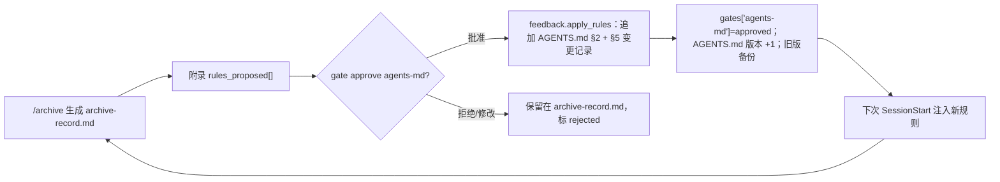

# 04 · 产物规范与 Hooks 契约

> 项目：AI-Native 全流程平台（Spec 驱动）· 个人同构 MVP
> 版本：v1.0 ｜ 更新：2026-11-01 ｜ 交付状态：**已交付并跑通**——产物/协议由 `tests/unit/test_artifact_schema.py`、`tests/unit/test_store.py`、`tests/contract/test_hooks.py`（19 个函数）覆盖，全量 **378 passed**；mock 全流程 ≈7.5s；live 已联调（qwen-plus）
> 上游：[PRD](./02-PRD.md)、[技术方案](./03-技术方案.md)、[07 详细设计与接口契约](./07-详细设计与接口契约.md) ｜ 下游：[里程碑与验收](./05-里程碑与验收.md)、[06 演示脚本与面试口径](./06-演示脚本与面试口径.md)、[08 工程规范与开发环境](./08-工程规范与开发环境.md)、[09 测试计划与验收矩阵](./09-测试计划与验收矩阵.md)
> 口径：本文的字段名、退出码、命令与 [07](./07-详细设计与接口契约.md) 冲突时**以 07 为准**；对应关系见 §9。

---

## 1. 产物总览与命名

| # | 产物 | 路径 | 产出阶段 | 谁读 |
|---|---|---|---|---|
| 1 | `AGENTS.md` | 目标仓库根 | S0A `/project-init`（S7 回灌更新） | SessionStart、所有阶段 |
| 2 | `domain.md` | 目标仓库根 | S0B `/domain-input` | SessionStart、Planner |
| 3 | `index.md` | 目标仓库根 | S0B 生成，S7 刷新 | 人、新会话 |
| 4 | `repo-profile.md` | `.spec/artifacts/` | S0A | `/explore`、`/tech-design` |
| 5 | `prd.md` | `.spec/artifacts/` | S1 | `/explore`、门控 |
| 6 | `exploration.md` | `.spec/artifacts/` | S2 | `/tech-design` |
| 7 | `design.md` | `.spec/artifacts/` | S3 | `/plan-task`、Verifier |
| 8 | `tasks.md` | `.spec/artifacts/` | S4 | `/add`、PostToolUse |
| 9 | `tdd-plan.md` | `.spec/artifacts/` | S5 Planner | Test Writer、Executor |
| 10 | `tdd-report.md` / `tdd-report.jsonl` | `.spec/artifacts/` | S5 TDDRunner | `/qa-validate` |
| 11 | `qa-report.md` | `.spec/artifacts/` | S6 | `/archive`、评审者 |
| 12 | `archive-record.md` | `.spec/artifacts/` | S7 | 下次会话、人 |

运行期还有三类**非产物**文件（不进 `artifacts.json` 的产物表）：`.spec/state.json`（状态）、`.spec/index/artifacts.json`（索引）、`.spec/traces/*.jsonl`（trace），字段见 [07 §3](./07-详细设计与接口契约.md#3-数据模型文件级)。

| 命名类别 | 规则 | 示例 |
|---|---|---|
| 产物文件 | 小写 kebab，固定名（不随需求变） | `tdd-report.md` |
| 阶段命令 | `/` + 小写 kebab | `/qa-validate` |
| 需求条目 / 任务 / 验收用例 | `REQ-01` / `T2` / `AC-07` | `REQ-03` |
| 规则 | 危险 `D-`、需确认 `A-`、白名单 `W-`、写入范围 `C-`、回灌 `R-` | `D-02`、`R-07` |
| 平台对象 | `DOC-` / `FEAT-` / `RUN-` + id | `DOC-2041` |
| 备份 / trace | `.spec/backup/<stem>.v<n>.md` / `hooks-YYYYMMDD.jsonl`、`stage-<slug>-<ts>.jsonl` | `design.v1.md` |

## 2. `AGENTS.md` 模板

```markdown
# AGENTS.md — <仓库名> 基线规则

> 版本：v0.2 ｜ 更新：2026-10-30 ｜ 由 specflow 维护，人工可编辑

## 1. 仓库画像
- 语言/运行时：Python 3.11
- 包管理：pip
- 入口：`src/visit_plan/__main__.py`
- 关键目录：`src/`（业务）、`tests/`（pytest）、`docs/prd/`（需求）

## 2. 工程规则（每条都必须可判定）
- R-01 新增函数必须有类型标注；公共函数必须有 docstring
- R-02 文件读写使用 `pathlib` 与 `encoding="utf-8"`
- R-03 禁止在业务代码里 `print`，日志走 `logging`
- R-04 测试命名 `test_<行为>_<条件>_<期望>`
- R-05 不引入新依赖，除非在 `design.md` 选型表中列出理由

## 3. 流程规则
- 进入 `/plan-task` 前 `design.md` 必须 approved
- 阶段产物写入 `.spec/artifacts/`，不得写到仓库根
- 危险命令被 deny 时，按理由中的替代方案执行

## 4. 命令基线
| 用途 | 命令 |
|---|---|
| 安装 | `pip install -e ".[dev]"` |
| 测试 | `pytest -q` |
| Lint | `ruff check src tests` |

## 5. 变更记录
- v0.2 ← 回灌 R-07、R-08（来源：需求 visit-import）
- v0.1 ← 初始化（`/project-init`）
```

约定：**§2 每条规则必须写明可判定的判据**（禁止类要给替代方案），否则模型无法遵守、Verifier 无法检查；`feedback.apply_rules` 只追加 §2/§5，§1/§4 由 `/project-init` 维护；**§2 硬上限 30 条**，超限抛 `UsageError`（提示先合并同类规则）。

## 3. `domain.md` 模板

```markdown
# domain.md — 拜访域知识

> 版本：v1 ｜ 更新：2026-10-30 ｜ 来源：`/domain-input --file docs/domain/visit.md`

## 1. 业务域全景
BD 每日按门店清单拜访：计划 → 签到 → 日志 → 总结。数据来源含 POI 与 Excel 导入。

## 2. 核心规则
| # | 规则 | 反例（违反即错） |
|---|---|---|
| DR-01 | 一个门店一天只能有一条生效拜访计划 | 同店同日两条计划都生效 |
| DR-02 | 签到时间必须早于签退时间 | 签退 09:00 / 签到 10:00 |
| DR-03 | 门店编码唯一，导入按编码去重 | 同编码两条只留一条却未标注 |

## 3. 术语表
| 术语 | 含义 | 易混项 |
|---|---|---|
| 计划 | 一次待执行的拜访任务 | ≠ 拜访记录 |
| 记录 | 已发生的签到/签退/日志 | ≠ 计划 |
| 门店编码 | 外部 POI 唯一键 | ≠ 内部门店 ID |

## 4. 边界与禁区
- 不改动计费相关字段（`billing_*`）；不直连生产库
```

`/domain-input` 缺失时，SessionStart 注入内置最小规则并声明"领域知识缺失，涉及业务判断必须先问"，不允许模型编造术语。`domain.md` 不在 `ARTIFACT_SCHEMAS` 的强校验表内（见 [07 §4.3](./07-详细设计与接口契约.md#43-artifactsschemapy)），其完整性由 AC-04 的章节/条目计数断言保证。

## 4. 各阶段产物最小必备字段

所有产物共用的 front-matter（标量/短数组；复杂结构见下方附录约定）：

```yaml
---
id: ART-DESIGN-0003
name: design.md
stage: S3
version: 2
status: draft          # draft | reviewed | approved | superseded
owner: lin.xu
created_at: 2026-10-30T20:14:03+08:00
updated_at: 2026-10-30T20:31:40+08:00
source: {type: file, ref: .spec/artifacts/exploration.md}
summary: 用事件表替换轮询，接口保持兼容，回滚靠开关
toc: ["1 选型对比", "2 模块改动", "3 接口变更", "4 风险与回滚"]
hash: 9f2c1a7b4d05
---
```

> **附录约定（ADR-003）**：front-matter 只放元数据；`requirements[]`/`modules[]`/`options[]`/`tasks[]`/`evidence[]`/`rules_proposed[]` 等复杂结构统一放正文末尾的 `## 附录：结构化数据` + ```` ```json ```` 块。`artifacts/schema.py` 的强校验读附录，缺失视为字段不全（该产物要求附录时）。不再使用 `evidence: []`、`deps: []`、`rules_proposed: []` 这类 front-matter 数组字段。

| 产物 | 额外必备 meta | 必备章节（缺一即门控失败） | 附录必填（结构化数据） | 结构断言 |
|---|---|---|---|---|
| `repo-profile.md` | — | §仓库画像、§命令基线 | `language, package_manager, test_command, entry_points[], convention_files[], commands[{purpose,command}]` | language 非空；commands ≥3；entry_points ≥1 |
| `prd.md` | `source` | §背景、§需求条目、§验收标准、§范围外 | `requirements[{id,title,desc,acceptance[]}]` | requirements ≥1；id 匹配 `^REQ-\d{2,}$`；每条 acceptance ≥1 |
| `exploration.md` | — | §受影响模块、§现有约束、§未知项 | `modules[{path,purpose}], constraints[], unknowns[{item,status}]` | modules ≥1；unknowns ≥1 且 `status ∈ {待确认, 已确认, 无}` |
| `design.md` | `gate` | §选型对比、§模块改动、§接口变更、§风险与回滚 | `options[{name,pros,cons}], changes[{path,change}], risks[{id,desc,mitigation,rollback}]` | options ≥2；changes ≥1 含路径；risks ≥3 且各含 rollback |
| `tasks.md` | `feature_id` | §任务表、§依赖顺序 | `tasks[{id,title,files[],test_first,estimate_h,acceptance[]}]` | 每任务 id 匹配 `^T\d+$`、files ≥1、test_first=true、0<estimate_h≤4、acceptance ≥1 |
| `tdd-plan.md` | `task_id`, `round` | §步骤、§验证方式 | `steps[{n,goal,files[],verify}]` | steps 1..8；每步 files ≥1、verify 非空 |
| `tdd-report.md` | `task_id`, `rounds`, `verdict`, `needs_human` | §执行摘要、§失败项、§最终测试结果 | `tasks[{task_id,rounds,verdict,passed,total,failures[]}]` | verdict ∈ {pass,fail,needs_human}；rounds ≥1 |
| `qa-report.md` | `verdict` | §单测、§pipeline、§rpc、§结论 | `evidence[{type,status,detail}]` | evidence 覆盖 unit/pipeline/rpc；status ∈ {passed,failed,skipped}；任一 failed → verdict=fail |
| `archive-record.md` | — | §变更摘要、§候选回灌规则、§复用条目 | `rules_proposed[{id,text,source,criteria,counterexample}]` | 每条 id 匹配 `^R-\d{2,}$`；text/criteria 非空 |

`tdd-report.jsonl`（与 `tdd-report.md` 互为正副本；**事件流**，TDDRunner 每步追加一行，顺序可断言）。行格式以 [07 §5.8](./07-详细设计与接口契约.md) 为准：在 07 §3.4 的公共字段（`ts/stage/step/status`…）之上**顶层追加** `round/role/event`，事件业务字段（`files`/`cases`/`passed`/`total`/`failure_items`/`elapsed_ms`/`tokens`）同样顶层追加（[08 §4](./08-工程规范与开发环境.md#4-数据与协议规范)：新增字段只追加、不改名）；注意它**不是** `.spec/traces/stage-*.jsonl` 阶段 trace：

```jsonl
{"ts":"2026-10-30T20:41:02+08:00","stage":"S5","round":1,"role":"planner","event":"plan_ready","steps":5,"elapsed_ms":41,"tokens":0}
{"ts":"2026-10-30T20:41:19+08:00","stage":"S5","round":1,"role":"test_writer","event":"test_written","files":["tests/test_importer.py"],"cases":5,"elapsed_ms":35,"tokens":0}
{"ts":"2026-10-30T20:42:05+08:00","stage":"S5","round":1,"role":"executor","event":"impl_written","files":["src/visit_plan/importer.py"],"elapsed_ms":33,"tokens":0}
{"ts":"2026-10-30T20:42:31+08:00","stage":"S5","round":1,"role":"verifier","event":"fail","passed":3,"total":5,"failure_items":["空行未跳过","重复编码未去重"],"elapsed_ms":812,"tokens":0}
{"ts":"2026-10-30T20:44:58+08:00","stage":"S5","round":2,"role":"verifier","event":"pass","passed":5,"total":5,"elapsed_ms":767,"tokens":0}
```

> AC-15 断言的"测试先于实现"= `event=test_written` 行的 `ts` 早于 `event=impl_written` 行（同一 `tdd-report.jsonl` 内顺序）。

## 5. Hooks 协议

### 5.1 注册与环境

`hooks.json`（仓库根，`specflow init` 复制到目标仓库；超时值以本文件为准）：

```json
{"hooks": {
  "SessionStart": [{"matcher": "startup|resume|clear|compact", "hooks": [{"type": "command", "command": "specflow hook SessionStart", "timeout": 10}]}],
  "UserPromptSubmit": [{"hooks": [{"type": "command", "command": "specflow hook UserPromptSubmit", "timeout": 10}]}],
  "PreToolUse": [{"matcher": "Bash|Shell|Write|Edit|MultiEdit", "hooks": [{"type": "command", "command": "specflow hook PreToolUse", "timeout": 5}]}],
  "PostToolUse": [{"matcher": "Write|Edit|MultiEdit|Bash", "hooks": [{"type": "command", "command": "specflow hook PostToolUse", "timeout": 5}]}]
}}
```

环境变量（以 [07 §2.1](./07-详细设计与接口契约.md#21-specflowconfigpy) 为准）：`SPECFLOW_PROJECT_DIR`、`LLM_MODE`（`SPECFLOW_MODE` 为别名）、`PLATFORM_MODE`、`SPECFLOW_OWNER`、`SPECFLOW_STRICT_HOOKS`、`SPECFLOW_SPEC_DIR`、预算与上限类变量。`session_id`/`event` 优先从 **stdin JSON** 读；`SPECFLOW_SESSION_ID` 仅作回退（runner/protocol），`SPECFLOW_ROLE`/`SPECFLOW_TASK_ID` 用于 Pre/PostToolUse 的角色与任务归属；trace 目录固定为 `<project>/.spec/traces/`。

**退出码约定**（ADR-010）：

| 码 | 含义 | 使用场景 | 数据通道 |
|---|---|---|---|
| `0` | 正常 / 结构化决策 | `PreToolUse` 的 allow/ask/deny、SessionStart/PostToolUse 注入、所有成功命令 | stdout 单行 JSON（可为空） |
| `2` | **硬阻断** | **仅** `UserPromptSubmit` 门控失败；`run` 的机器门/人门失败；`status --check` 不一致 | stderr 单行 ≤200 字（进入模型上下文）；trace 记结构化原因 |
| `3` | 需人工介入 | 写锁占用、连续 3 次门控失败、TDD 超限 | stderr 一行 + stdout 的 `specflow` 字段 |
| `1` | 运行错误 | 参数/IO/LLM/schema 校验失败 | stderr（仅日志语义） |

> **原则**：**能用 stdout JSON 表达的结构化决策走 `0 + JSON`；只有"必须停"的硬阻断用 `2 + stderr`**。因此 `PreToolUse` 的 deny/ask **不是** exit 2——宿主读 `permissionDecision` 决定"拒绝/询问"，同时还能把 `permissionDecisionReason`（替代方案）给模型；若用 exit 2 整场中止工具调用，替代方案与后续对话都会丢。stderr 单行 ≤200 字，因其会进入模型上下文。

### 5.2 `SessionStart`

stdin：`{"session_id":"ses_01J8Z2K6QF","hook_event_name":"SessionStart","source":"startup","cwd":"C:/work/demo-repo","transcript_path":"C:/work/demo-repo/.spec/traces/transcript-01.jsonl"}`

stdout（exit 0）：

```json
{
  "continue": true,
  "hookSpecificOutput": {
    "hookEventName": "SessionStart",
    "additionalContext": "## 基线规则（AGENTS.md v0.2，节选）\n- R-01 新增函数必须有类型标注\n- R-02 文件读写用 pathlib + utf-8\n\n## 模板索引\n- templates/prd.md（PRD 结构）\n- templates/test_unit.py（测试骨架）\n- templates/design.md（选型/风险表）\n\n## 当前阶段\nS4 任务拆解：design.md 已 approved；下一步 /plan-task。\n需要细节时读锚点：domain.md#2-核心规则、.spec/artifacts/design.md#3-接口变更"
  },
  "specflow": {"stage": "S4", "context_tokens": 412, "sources": ["AGENTS.md#2", "templates/index", ".spec/state.json"], "degraded": false}
}
```

### 5.3 `UserPromptSubmit`

stdin：`{"session_id":"ses_01J8Z2K6QF","hook_event_name":"UserPromptSubmit","cwd":"C:/work/demo-repo","prompt":"/explore --scope src/visit_plan"}`

通过（exit 0，注入上游摘要 ≤300 tokens）：

```json
{
  "continue": true,
  "hookSpecificOutput": {
    "hookEventName": "UserPromptSubmit",
    "additionalContext": "阶段 S2 综合探索｜门控 prd.md=approved ✓\nPRD 摘要：拜访计划批量导入，需去重、失败回执、图片识别；范围外：不做批量删除。\n条目：REQ-01 导入模板、REQ-02 去重、REQ-03 失败回执。\n细节读：.spec/artifacts/prd.md#2-需求条目"
  },
  "specflow": {"stage": "S2", "gate": "pass", "context_tokens": 268, "artifact_refs": ["prd.md"]}
}
```

门控失败（越级 `/plan-task`，`design.md` 仍 `draft`）——**exit 2，stderr 单行**，stdout 为空：

```text
[specflow] 门控未通过：/plan-task 需要 design.md 状态 approved（当前 draft，v1）。补齐：specflow run "/tech-design" 后 specflow gate approve design --as <你> --note "<结论>"。
```

结构化原因落 trace（`.spec/traces/hooks-YYYYMMDD.jsonl`，行格式见 [07 §3.3](./07-详细设计与接口契约.md#3-数据模型文件级)）：

```json
{"ts": "2026-10-30T20:31:40+08:00", "session_id": "ses_01J8Z2K6QF", "event": "UserPromptSubmit", "decision": "block", "rule_id": null, "exit_code": 2, "elapsed_ms": 12, "context_tokens": 0, "artifact_refs": ["design.md"], "error": null}
```

同一命令连续 3 次门控失败 → 退出码 `3`，stderr 附"已连续 3 次未通过，停止自动重试"（`NeedsHuman` 语义）。

### 5.4 `PreToolUse`

stdin：

```json
{"session_id":"ses_01J8Z2K6QF","hook_event_name":"PreToolUse","cwd":"C:/work/demo-repo",
 "tool_name":"Bash","tool_input":{"command":"git reset --hard HEAD~3","description":"清理工作区后重来"},
 "tool_use_id":"toolu_01VB9QX7"}
```

deny（**exit 0** + JSON；必须给替代方案）：

```json
{"hookSpecificOutput": {"hookEventName": "PreToolUse", "permissionDecision": "deny",
  "permissionDecisionReason": "拒绝执行：命中 D-02（git reset --hard），会丢弃未提交改动。改用 `git stash push -m specflow-backup` 暂存，或 `git restore -- <path>` 只还原指定文件。"},
 "specflow": {"rule_id": "D-02", "severity": "block", "stage": "S5", "elapsed_ms": 41}}
```

ask（`rm -rf ./build`，非仓库根 → 人工确认；命中 A-01）：

```json
{"hookSpecificOutput": {"hookEventName": "PreToolUse", "permissionDecision": "ask",
  "permissionDecisionReason": "命中 A-01：删除构建产物目录（非法定根路径）。确认可重建后再继续。"},
 "specflow": {"rule_id": "A-01", "severity": "confirm", "elapsed_ms": 38}}
```

allow（白名单短路，避免"重构脚本里含 rm 就误杀"）：

```json
{"hookSpecificOutput": {"hookEventName": "PreToolUse", "permissionDecision": "allow"},
 "specflow": {"rule_id": "W-01", "severity": "allow", "matched": "pytest -q", "elapsed_ms": 12}}
```

写入范围规则 C-01（Executor 改 `tasks.md` 未声明的文件；**exit 0** + deny）：

```json
{"hookSpecificOutput": {"hookEventName": "PreToolUse", "permissionDecision": "deny",
  "permissionDecisionReason": "拒绝写入 src/visit_plan/billing.py：不在 T1 声明的写入范围内（声明：src/visit_plan/importer.py, tests/test_importer.py）。如需扩大范围，先更新 tasks.md 并重新门控。"},
 "specflow": {"rule_id": "C-01", "severity": "block", "task_id": "T1"}}
```

### 5.5 `PostToolUse`

stdin：`{"session_id":"ses_01J8Z2K6QF","hook_event_name":"PostToolUse","cwd":"C:/work/demo-repo","tool_name":"Write","tool_input":{"file_path":"C:/work/demo-repo/src/visit_plan/importer.py","content":"<略>"},"tool_response":{"success":true,"bytes":4213}}`

stdout（**exit 0**，产物追踪 + 索引刷新，不阻断）：

```json
{
  "continue": true,
  "hookSpecificOutput": {
    "hookEventName": "PostToolUse",
    "additionalContext": "产物已登记：src/visit_plan/importer.py → T1（hash 3b7e12c9a0f4）。任务覆盖 1/1，索引已刷新 .spec/index/artifacts.json。"
  },
  "specflow": {"tracked": {"path": "src/visit_plan/importer.py", "task_id": "T1", "hash": "3b7e12c9a0f4"}, "index_updated": true, "elapsed_ms": 57}
}
```

PostToolUse 只认 `continue/additionalContext`；返回 `permissionDecision` 会被协议层校验丢弃（此时工具已执行）。

## 6. 阶段门控规则表

门控是纯函数 `gate.check(stage, store, state) -> GateResult(passed, missing[], reasons[], howto, details)`，`status --check`、`UserPromptSubmit`、`runner` 三处复用同一实现，避免文档与代码两套规则。`GateResult.reasons` 形如 `design.md:status=draft(需 approved)`。

| 目标命令 | 必需产物 | 校验内容 | 未通过时 | 阻断通道 |
|---|---|---|---|---|
| `/domain-input` | `AGENTS.md` | 存在且含 §2/§4 | 提示先跑 `/project-init` | UP：exit 2 + stderr（run 侧同 exit 2） |
| `/explore` | `prd.md` | 存在；front-matter 合法；附录 requirements ≥1 | 提示补 PRD | UP：exit 2 + stderr |
| `/tech-design` | `exploration.md` | 存在；三节齐全；unknowns ≥1 且状态合法 | 要求补未知项或标"无" | UP：exit 2 + stderr |
| `/plan-task` | `design.md` + 人门 `design` | **status=approved**；hash 与 state 一致；附录 risks ≥3；`gates.design.status=approved` | 提示 `gate approve design` | UP：exit 2 + stderr |
| `/add` | `tasks.md` | 附录任务齐全：`test_first=true`、estimate_h ≤4、files 非空 | 提示修 `tasks.md` | UP：exit 2 + stderr |
| `/qa-validate` | `tdd-report.md` | `verdict=pass`、`needs_human=false` | 提示回流或人工修复 | UP：exit 2 + stderr |
| `/archive` | `qa-report.md` | `verdict=pass`；附录 evidence 覆盖三段 | 提示补 pipeline/rpc | UP：exit 2 + stderr |
| 写 `approved` 产物 | 该产物 | 正文 hash 与 state 一致（C-04） | 判 `tampered`，要求 `gate revise` | PreToolUse：exit 0 + JSON deny |

> 说明：`/archive` 本身不被 `agents-md` 人门阻断；回灌动作由 `specflow gate approve agents-md` 触发（[ADR-009](./07-详细设计与接口契约.md#0-实现决策记录adr)）。已批准产物要重做时，需先 `specflow gate supersede <name>`（人工流程），`gate.check` 不自动校验 `superseded` 状态。

## 7. 规则回灌机制



| 环节 | 规则 |
|---|---|
| 来源 | 只接受本次 `archive-record.md` 附录的 `rules_proposed[]`（含 `R-` 编号、来源需求、判据、反例） |
| 去重 | 与既有规则文本相似度 ≥0.9 视为重复，记 `skipped_duplicate` |
| 冲突 | 语义相反（如"必须写测试" vs "仅核心模块写测试"）不自动合并，输出冲突对交人工 |
| 生效 | 只能经 `specflow gate approve agents-md`；`AGENTS.md` 版本 +1 并写 §5 |
| 回滚 | `.spec/backup/AGENTS.v<n>.md` 保留上一版，`specflow restore AGENTS.md` 一键回退 |
| 上限 | §2 硬上限 30 条；超限抛 `UsageError`（先合并同类规则，防规则膨胀吃满注入预算） |

`feedback.apply_rules(agents_path, proposals, *, owner, source_req, backup_path)` 返回 `{"version", "added", "skipped_duplicate", "conflicts", "appended"}`，只追加不改旧规则（[07 §4.6](./07-详细设计与接口契约.md#46-artifactsfeedbackpy)）。

## 8. 文件锁与并发约定

`.spec/locks/<artifact>.lock`，内容为 JSON（一次写全，避免读到半截）：

```json
{"artifact":"design.md","pid":28412,"owner":"lin.xu","session_id":"ses_01J8Z2K6QF",
 "host":"DESKTOP-7K2","acquired_at":"2026-10-30T20:14:03+08:00","expire_at":"2026-10-30T20:16:03+08:00"}
```

| 约定 | 规则 |
|---|---|
| 获取 | `O_CREAT\|O_EXCL` 原子创建；失败即"被占用"，**不重试不等待**，退出码 3 |
| TTL / 续期 | 120s；长阶段每 30s `renew()` 重写 `expire_at` |
| 抢占 | `expire_at` 过期允许抢占，旧锁复制为 `<artifact>.lock.stale.<ts>` 留证 |
| 释放 | `finally` 删除；进程崩溃残留由下次获取时的 TTL 检查清理 |
| 粒度 | 一产物一锁（`design.md` 与 `tasks.md` 可并行），不做仓库级大锁 |
| 只读者 | Hooks（门控校验、PostToolUse）**只读不加锁**，避免 hook 阻塞编辑；写操作只在 CLI 侧 |
| 单写者 | 同一阶段同一时刻只允许一个会话写产物；`/add` 内部按 `tasks.md` 顺序串行 |
| 跨平台 | Windows 无 `fcntl`，统一用"创建 + 独占"文件语义，不依赖平台锁 API |

冲突提示固定一行：`design.md 正被 ses_…写入（owner=lin.xu，剩余 82s），请稍后重试或 specflow unlock design --force`。

## 9. 与 07 的对应关系（零冲突自检）

| 本文内容 | 07 事实源 | 本文遵循的定稿 |
|---|---|---|
| §4 产物 front-matter / 附录 / 结构断言 | 07 §3.6、§4.2、§4.3 | 附录 JSON 承载复杂结构（ADR-003）；hash 只对正文（ADR-006） |
| §5.1 退出码表 | 07 §2.2、§5.6、§0 ADR-010 | PreToolUse deny/ask 用 exit 0 + JSON；仅 UserPromptSubmit 硬阻断用 exit 2 + stderr |
| §5.2–5.5 payload | 07 §5.6 | stdin 字段取自宿主 JSON；stdout 单行 JSON；trace 走 07 §3.3 |
| §6 门控规则 | 07 §5.4 | `gate.check(stage, store, state)`；人门只 `design`/`agents-md`（ADR-009） |
| §7 回灌 | 07 §4.6 | 相似度 ≥0.9、§2 上限 30、只追加、版本 `vX.Y→vX.(Y+1)` |
| §8 锁 | 07 §3.5、§4.5 | TTL 120s、`O_CREAT\|O_EXCL`、过期抢占留证、`LockBusy` exit 3 |