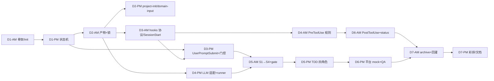

# 05 · 里程碑与验收

> 项目：AI-Native 全流程平台（Spec 驱动的 Agentic Software Engineering）· 个人同构 MVP
> 版本：v1.0 ｜ 更新：2026-11-01 ｜ 交付状态：**已交付并跑通**——`python -m pytest -q` → **378 passed**；`python scripts/demo.py --mode mock --reset` → 全流程 **≈7.5s**；AC-01~22 全部通过（明细见 [09 §7](./09-测试计划与验收矩阵.md#7-验收记录与出表)）；**live 已真实联调**：阿里云百炼 `qwen-plus` 全流程 **145.74s**（9 次调用（阶段 6 + TDD 3），不承诺 90s）
> 上游：[PRD](./02-PRD.md)、[技术方案](./03-技术方案.md)、[07 详细设计与接口契约](./07-详细设计与接口契约.md) ｜ 下游：[06 演示脚本与面试口径](./06-演示脚本与面试口径.md)、[08 工程规范与开发环境](./08-工程规范与开发环境.md)、[09 测试计划与验收矩阵](./09-测试计划与验收矩阵.md)

---

## 1. 范围约定

| 范围 | 内容 | 必须完成 |
|---|---|---|
| **P0** | `/project-init`、`/domain-input`、`/prd-input`、`/explore`、`/tech-design`、`gate approve/reject design`、`/plan-task`、`/add` 四角色循环、SessionStart、UserPromptSubmit、PreToolUse、产物模板 + `.spec` 骨架 | 是（Day 1–5） |
| **P1** | PostToolUse 索引刷新、`/qa-validate`、`/archive` + 规则回灌、平台 mock 五个、`status/doctor/restore/unlock` | 是（Day 6–7，可裁剪但影响演示完整度） |
| **不做** | 真实平台接入、SSO 真实认证、Web UI、向量检索、多人权限 | 否 |

工期：**7 天 / 单人 / 每天两个半天块**，共 14 块。每块结尾必须留下可运行的东西（"半天不交付 = 半天返工"）。阶段 ID 统一为 S0A/S0B + S1–S7（与 `state.json` 的 `stage` 枚举一致，见 [07 §3.1](./07-详细设计与接口契约.md#31-specstatejson)）。

## 2. 七天任务拆分（半天粒度，已全部完成）

| 块 | 任务 | 交付物（可验证） | 依赖 |
|---|---|---|---|
| D1-AM | 仓库骨架：`pyproject.toml`（dependencies=[]）、`cli.py`、`config.py`、`.env.example`、`hooks.json`、`.spec` 骨架生成 | `specflow init` 在临时目录生成完整 `.spec/` 与 `AGENTS.md` 初版（AC-01） | — |
| D1-PM | 阶段定义与状态机：`skills/*/SKILL.md`、`stages.py`、`state.py`（原子写）、非法转移报错 | `pytest tests/unit/test_state.py` 全绿；`state.json` 结构固定 | D1-AM |
| D2-AM | 产物管理器：`frontmatter.py`/`store.py`（备份/回滚）、`lock.py`、`schema.py` 首批 4 个产物契约 | 产物读写 + 备份 + 锁的单测通过 | D1-PM |
| D2-PM | `/project-init` + `/domain-input`：仓库画像、模板提取、命令基线、`domain.md`、`index.md` | fixture 仓库跑通两命令，产物字段齐全（AC-02~AC-04） | D2-AM |
| D3-AM | Hooks：`protocol.py`、`manager.py`、`session_start.py` | `echo '<json>' \| python -m specflow hook SessionStart` 返回合法 JSON，`context_tokens` ≤900（AC-11） | D2-AM |
| D3-PM | `user_prompt_submit.py`（命令解析/阶段识别/门控/摘要）+ 门控规则用例 | 越级命令被 block，退出码 2；门控单测全绿（AC-05…AC-10） | D3-AM、D1-PM |
| D4-AM | `pre_tool_use.py` 规则引擎（W/D/A/C 四表）+ 危险命令语料 | 20 条危险样例全 deny、10 条白名单全 allow（AC-12/13/14） | D3-AM |
| D4-PM | LLM 适配层：`openai_compat.py`（urllib）、`mock.py`（scenario 查表）+ 阶段 runner 骨架 | 无 Key 时 `/explore` 产出 `exploration.md` | D2-AM |
| D5-AM | S1→S4 四阶段（prd/explore/design/tasks）+ `gate approve/reject` | `design.md` 未批准时 `/plan-task` 阻断；批准后放行（AC-06/07/08） | D4-PM、D3-PM |
| D5-PM | TDD 编排器：四角色 + 回流上限 3 轮 + `tdd-report.jsonl` | mock 下"首轮失败→回流→pass"，轮次=2（AC-15/16/17） | D5-AM、D4-PM |
| D6-AM | `post_tool_use.py` 索引刷新 + `status --check`、`doctor` | 写文件后索引可见；`status` 打印 9 阶段表（AC-18） | D4-AM |
| D6-PM | 平台 mock 五件套 + `/qa-validate` 三段证据 | `qa-report.md` 含 pipeline/rpc/单测三段 + verdict（AC-19） | D5-PM |
| D7-AM | `/archive` + 规则回灌 + `restore`；全量回归 | 回灌后重开会话可见新规则（AC-20）；AC-01…AC-22 逐条过矩阵（[09](./09-测试计划与验收矩阵.md)） | D6-AM、D6-PM |
| D7-PM | 演示彩排 + 文档校对 + 录屏 + 面试口径 | mock 脚本一遍过、断网 ≤90s、文档链接零断链 | 全部 |

**裁剪预案**（若落后半天以上）：先砍 D6-PM 的 rpc mock（QA 报告标 `skipped`），再砍 `/domain-input` 的反例列；**不砍** PreToolUse 与门控——它们是演示的核心差异点。

> **实际执行结果**：14 块全部完成，无裁剪；最终回归 `python -m pytest -q` → **378 passed**（280 个测试函数，含参数化），mock 演示全流程 **≈7.5s**（2026-10-30）。

## 3. 依赖关系

关键路径：`骨架 → 状态机 → 产物管理器 → 阶段引擎 → TDD → QA → 归档`。Hooks 与阶段引擎**并行可行**（协议层先去耦），这是把 7 天压进单人可行的关键。

## 4. 验收用例（AC）

断言方式列：`pytest` 指自动化测试文件与用例名（完整映射、fixture、运行命令与期望断言见 [09 §4 验收矩阵](./09-测试计划与验收矩阵.md#4-验收矩阵)）；`命令` 指可复现的 shell 断言；`人` 指人工检查点。**验收结果（2026-10-30）：AC-01~22 全部通过（378 passed），逐条证据见 [09 §7 验收记录](./09-测试计划与验收矩阵.md#7-验收记录与出表)。**

| ID | 用例 | 输入 | 期望产物/行为 | 断言方式（实际用例） |
|---|---|---|---|---|
| AC-01 | 初始化生成骨架 | 空目录执行 `specflow init` | 生成 `AGENTS.md`、`hooks.json`、`.spec/state.json` 与 5 个目录（artifacts/traces/locks/backup/index） | `tests/e2e/test_flow.py::test_offline_full_flow`（init 段） |
| AC-02 | 仓库画像完整 | `/project-init`（fixture 仓库） | `repo-profile.md` 附录含 language/package_manager/test_command/entry_points/commands；commands ≥3、entry_points ≥1 | `tests/e2e/test_flow.py::test_offline_full_flow`（profile 段） |
| AC-03 | 模板提取 | 同上 | `templates/` ≥3 个文件，含占位符 `<...>` 与示例 | `tests/e2e/test_flow.py::test_offline_full_flow`（templates 段） |
| AC-04 | 领域产物 | `/domain-input --file fixtures/domain.md` | `domain.md` 术语 ≥8、规则 ≥5、每条有反例 | `tests/e2e/test_flow.py::test_offline_full_flow`（domain 段） |
| AC-05 | 缺 PRD 阻断探索 | 干净仓库直接 `/explore` | 不调用 LLM，`exit 2`（stderr 提示补 `/prd-input`） | `tests/contract/test_hooks.py::test_user_prompt_submit_gate_failure_blocks_with_exit_2` + `tests/unit/test_gate.py::test_missing_upstream_artifact_blocks` |
| AC-06 | 未批准方案阻断拆解 | `design.md` 为 `draft` 时 `/plan-task` | 阻断，`reason` 含 `design.md` 与 `gate approve` 指引 | `tests/unit/test_gate.py::test_draft_design_blocks_with_actionable_reason` + `test_human_gate_pending_blocks` |
| AC-07 | 批准后放行 | `gate approve design --as tester` 后 `/plan-task` | 放行，生成 `tasks.md`；`state.json` 的 `gates.design.status=approved` | `tests/unit/test_gate.py::test_approved_design_passes` + `tests/e2e/test_flow.py::test_offline_full_flow`（approve→plan-task 段） |
| AC-08 | 打回可重做 | `gate reject design --note "缺压测"` 后 `/tech-design` | `design.md` 回 `draft`，`gates.design` 记录拒绝，重做时注入打回意见 | `tests/unit/test_gate.py::test_reject_then_redo_flow` |
| AC-09 | 三连失败不烧 token | 同一命令连续 3 次门控失败 | 第 3 次起 `exit 3`，LLM 调用次数不增 | `tests/unit/test_gate.py::test_gate_failure_counter_three_times` + `tests/contract/test_hooks.py::test_user_prompt_submit_repeated_failures_exit_3` |
| AC-10 | 篡改检测 | 手动改 `approved` 的 `design.md` 正文 | 门控拒绝，`status --check` 标 `tampered` | `tests/unit/test_gate.py::test_tampered_approved_artifact_blocks` + `test_check_artifact_detects_tamper` |
| AC-11 | SessionStart 注入 | `python -m specflow hook SessionStart < json` | 返回 `additionalContext` 含规则与模板索引，`context_tokens` ≤900 | `tests/contract/test_hooks.py::test_session_start_truncates_over_budget`（+ inject/trace 用例） |
| AC-12 | 危险命令阻断 | `git reset --hard HEAD~3`、`rm -rf /`、`:(){:\|:&};:` 等 20 条 | 全部 `permissionDecision=deny` 且 `exit 0`，理由含替代方案 | `tests/unit/test_rules.py::test_danger_command_denied_with_alternative`（参数化 20 例）+ contract deny 用例 |
| AC-13 | 白名单零误伤 | `pytest -q`、`git status`、`ruff check src` 等 10 条 | 全部 `allow`，`rule_id` 以 `W-` 开头 | `tests/unit/test_rules.py::test_whitelisted_command_allowed`（10 条）+ contract allow 用例 |
| AC-14 | 写入范围限制 | `tasks.md` 只声明 `importer.py`，Executor 改 `billing.py` | deny，`rule_id=C-01`，理由含声明范围 | `tests/unit/test_rules.py::test_c01_out_of_scope_write_denied`（+ C-02/C-03/C-04）+ contract scope 用例 |
| AC-15 | 测试先于实现 | `/add --task T1`（mock 首轮失败脚本） | `tdd-report.jsonl` 中 `event=test_written` 早于 `event=impl_written` | `tests/e2e/test_tdd.py::test_tdd_two_rounds_pass_end_to_end` |
| AC-16 | 失败回流 | 同上 | 轮次=2，第一轮 `fail` 含 `failure_items`，第二轮 `pass`，最终 `verdict=pass`（5/5） | `tests/e2e/test_tdd.py::test_tdd_two_rounds_pass_end_to_end` |
| AC-17 | 回流上限 | mock 每轮全失败 | 第 3 轮后停止，`needs_human=true`，测试文件保留，`exit 3` | `tests/e2e/test_tdd.py::test_tdd_exceeding_max_rounds_needs_human` |
| AC-18 | 产物追踪 | `Write` 写 `src/.../importer.py` 后触发 PostToolUse | `.spec/index/artifacts.json` 含该文件，`task_id=T1`，hash 非空 | `tests/unit/test_indexer.py::test_register_file_relative_and_absolute` + `test_rebuild_markdown_three_sections` + contract `test_post_tool_use_registers_file_into_index` |
| AC-19 | QA 三段证据 | `/qa-validate --fixture pipeline-fail` | `qa-report.md` 附录 evidence 含单测/pipeline/rpc 三段；`verdict=fail` 并指出失败段 | `tests/e2e/test_flow.py::test_offline_full_flow`（pass 段）+ `tests/e2e/test_qa_fail.py::test_qa_pipeline_failure_blocks_archive`（fail 段） |
| AC-20 | 归档回灌 | `/archive` + `gate approve agents-md` | `archive-record.md` 含 `rules_proposed[]`；`AGENTS.md` 版本 +1（v0.3）且含新增 `R-` 编号 | `tests/e2e/test_flow.py::test_offline_full_flow`（回灌段）+ `tests/unit/test_feedback.py::test_apply_rules_appends_and_bumps_version` |
| AC-21 | 离线可跑 | 断网 + `LLM_MODE=mock` + `PLATFORM_MODE=mock` 跑完整脚本 | 0 socket 连接（socket 打桩断言），全程 ≤90s（实测 ≈7.5s） | `tests/e2e/test_flow.py::test_offline_full_flow` |
| AC-22 | 并发写保护 | 两个进程同时写 `design.md` | 后者退出码 3，提示持锁 owner 与剩余 TTL | `tests/unit/test_lock.py::test_second_writer_blocked` + `test_second_process_gets_exit_code_three` |

**验收结论**：P0/P1 自动化全部通过；live 已用阿里云百炼 `qwen-plus` 真实联调一次（全流程 145.74s、9 次调用（阶段 6 + TDD 3）、exit 0，TDD 首轮 3/3、QA pass、回灌 R-06~R-08），live 不计入 AC 通过条件、也不承诺时延（见 [09 §5](./09-测试计划与验收矩阵.md#5-live-模型人工验收清单)）。覆盖率与已知缺口见 [09 §6](./09-测试计划与验收矩阵.md#6-覆盖率与已知缺口)。

## 5. 手工验收步骤

1. `git clone` 本仓库 → `python -m venv .venv` → 激活 → `pip install -e ".[dev]"`（无第三方运行时依赖）。
2. `python -m specflow doctor`：应显示 `llm_mode=mock`、`platform_mode=mock`、`hooks=installed`、`fixtures=ok`，无 FAIL 项。
3. 复制 `fixtures/demo-repo` 到 `.demo/visit-import`（ADR-007：fixture 只读），`cd` 进去，`specflow init` → 检查 `AGENTS.md`、`hooks.json` 与 `.spec/`。
4. 依次执行（无宿主 hooks 时用 `specflow run` 走同一引擎，ADR-005）：
   `specflow run "/project-init"` → `specflow run "/domain-input --file docs/domain/visit.md"` → `specflow run "/prd-input docs/prd/visit-import.md"`。
5. 故意 `specflow run "/plan-task"`：确认被阻断（exit 2，stderr 提示含 `design.md`）。连续 3 次后应停止调用模型并转 `exit 3`。
6. `specflow run "/explore"` → `specflow run "/tech-design"` → `specflow gate approve design --as <你> --note "选型可接受"` → `specflow run "/plan-task"`。
7. `specflow run "/add --task T1"`：屏幕输出应依次出现 plan → 测试文件 → 实现文件 → 第一轮失败摘要 → 第二轮 pass。
8. `git status` 确认只改了 `tasks.md` 声明的文件；再让 AI 执行 `rm -rf /` 与 `git reset --hard`，均被 deny（exit 0 + JSON）。
9. `specflow run "/qa-validate"` → 三段全 pass；`specflow run "/qa-validate --fixture pipeline-fail"` → 确认 `verdict=fail` 且定位到 pipeline 段，`/archive` 被门控拦住；切回默认再跑一次 → `specflow run "/archive"` → `specflow gate approve agents-md --as <你>`。
10. 关闭会话重开：`SessionStart` 注入里应出现新规则；`specflow status --check` 全 ✓；`python -m pytest -q` 全绿；`python -m specflow doctor` 无 FAIL。

## 6. 演示前自检清单

| # | 检查项 | 命令/动作 | 通过标准 |
|---|---|---|---|
| 1 | 环境干净 | `git status --short` | 只有预期改动，无 `.spec/backup` 垃圾、无 `.demo/` 残留 |
| 2 | 依赖就绪 | `python -m pytest -q` | 378 passed，无 fail、无 skip 掩盖 |
| 3 | 离线模式 | 断网重跑步骤 4–9（`LLM_MODE=mock`、`PLATFORM_MODE=mock`） | 全部成功，无超时、无 socket 连接 |
| 4 | 状态复位 | `Remove-Item .spec -Recurse -Force; specflow init`（或 `rm -rf .spec && specflow init`） | 演示从零开始，可重复 |
| 5 | 时长控制 | `python scripts/demo.py --mode mock --reset` / `--mode live --reset` | mock 实测 ≈7.5s（目标 ≤90s）；live 实测 145.74s（单阶段 10–40s，不承诺 90s）；口径见 [06 §1](./06-演示脚本与面试口径.md#1-演示脚本mock-与-live-两套时长) |
| 5b | live 可用性（可选） | `.env` 填 `LLM_MODE=live` + 百炼 Key；`python scripts/demo.py --mode live --reset` | exit 0；9 次调用（阶段 6 + TDD 3）；`design.md` 选型 ≥2、`tasks.md` T1–T3、`qa-report` verdict=pass、`AGENTS.md` v0.3；失败立即切 mock |
| 6 | 危险命令样例可复现 | 固定输入 `git reset --hard HEAD~3` | 稳定 deny，理由文案为预期版本 |
| 7 | 注入体积 | 看 trace 的 `context_tokens` | SessionStart ≤900、UserPromptSubmit ≤300 |
| 8 | 产物可读 | 打开 `design.md`、`qa-report.md` | 表格完整、无 `<占位符>` 残留、附录 JSON 可解析 |
| 9 | 文档链接 | 逐份点开 docs 里所有链接 | 零断链，图片可显示 |
| 10 | 录屏备份 | 完整脚本录屏 1 份（mock 与 live 各一段更佳） | 现场环境故障时可播 |

## 7. 实际交付记录（2026-10-30）

| 维度 | 交付结果 | 证据 |
|---|---|---|
| 阶段命令 | 9 条阶段命令（S0A/S0B + S1–S7）+ 8 个管理子命令全部可用 | `specflow init/run/status/gate/hook/doctor/restore/unlock` |
| Hooks | 4 个 hook（SessionStart / UserPromptSubmit / PreToolUse / PostToolUse）协议跑通 | `tests/contract/test_hooks.py` 19 个函数（19 条通过） |
| TDD | 四角色闭环、mock 2 轮收敛、超限 needs_human | `tests/e2e/test_tdd.py` 5 个函数 |
| 产物/门控 | 9 类产物 schema+附录校验、机器门/人门、hash 篡改检测 | `tests/unit/test_artifact_schema.py`/`test_gate.py`/`test_store.py` |
| 平台适配 | mock 五件套 + HTTP live 适配层（本地 stub）+ 失败分支 | `tests/unit/test_platforms.py`、`tests/contract/test_platform_http.py` |
| 规则回灌 | `/archive` → `gate approve agents-md` → `AGENTS.md` v0.3，重开会话注入生效 | `tests/e2e/test_flow.py` + `tests/unit/test_feedback.py` |
| 自动化回归 | **378 passed**（280 个测试函数，含参数化） | `python -m pytest -q` |
| mock 演示 | 全流程 **≈7.5s**，含越级阻断/TDD 2 轮/QA 三段/回灌/`status --check [OK]`/`doctor` 全 PASS | `python scripts/demo.py --mode mock --reset` |
| live 演示 | **已联调（2026-10-30）**：阿里云百炼 `qwen-plus`（OpenAI 兼容，`LLM_MODE=live`），全流程 **145.74s**、**9 次真实调用（阶段 6 + TDD 3）**、exit 0；TDD **首轮 3/3 通过（rounds=1）**、QA 三段 verdict=pass、回灌 **R-06/R-07/R-08**（`AGENTS.md` → v0.3，8 条规则）、`status --check` 通过、`doctor` 全 PASS | `python scripts/demo.py --mode live --reset`（单阶段 10–40s；分段：S0B 27.1s、S1 15.2s、S2 11.9s、S3 22.5s、S4 17.9s、S5 29.6s、S7 18.4s） |
| 环境适配 | Windows 沙箱 0o700 → mkdir mode 降级 + 独立 basetemp；子进程 `encoding="utf-8", errors="replace"`；CLI GBK 兜底 | 378 passed 在当前机器可复现 |

> 口径提醒：不写"效率提升 xx%"、不写未测量的覆盖率；live 只写**一次 qwen-plus 实测**，不承诺时延、不外推到其它模型/厂商；mock 仍是现场主演示（2.4 分钟的 live 用于加分）。